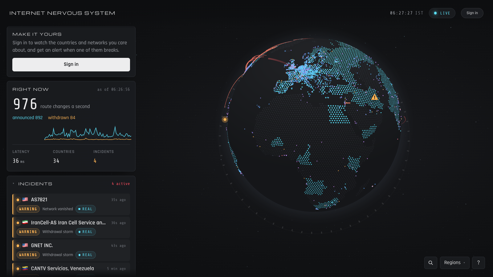
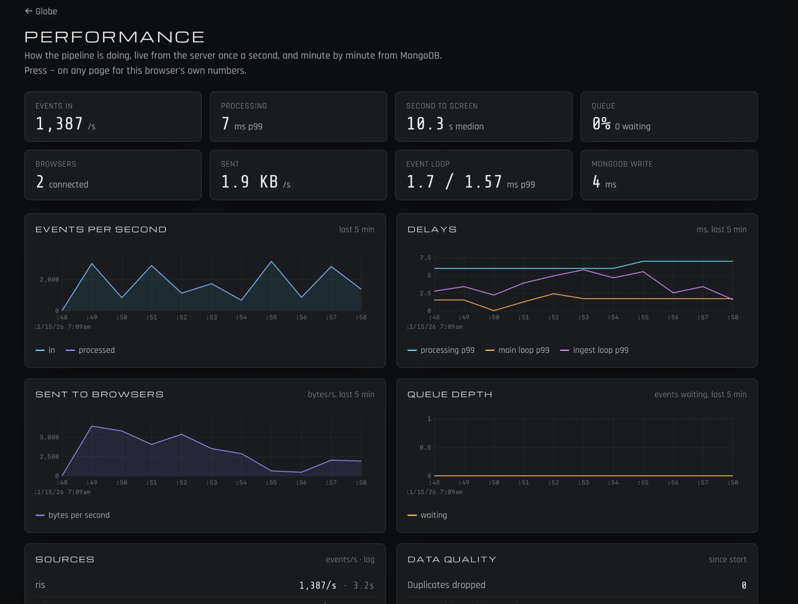
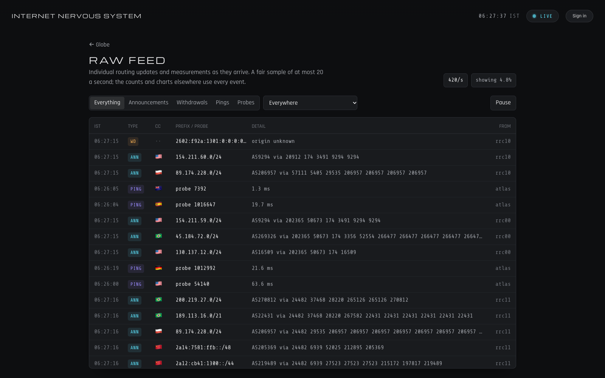
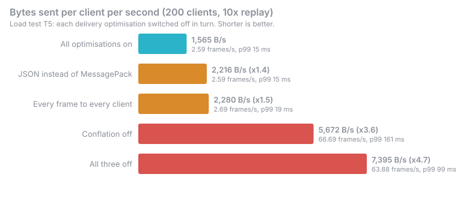

# Internet Nervous System

**A live 3D globe of the internet's health, built from real-time routing, latency and attack
telemetry.** It ingests every BGP routing change seen by RIPE's route collectors, latency
measurements from 15,000+ RIPE Atlas probes and Cloudflare Radar's attack and outage reports;
detects outages and hijacks as they happen; stores the history in MongoDB; and streams
room-scoped, delta-only updates to every browser over Socket.IO.

Built for **MERNIFY: High-Throughput Streams & Telemetry** by team **ProIdentifiers** (Harsh Sinha,
Santhosh Vodnala).

| | |
|---|---|
| **Live app** | _link added after deployment_ |
| **Demo video** | _link to be added_ |
| **Architecture** | [`docs/architecture.md`](docs/architecture.md) (diagrams, schema, protocols, optimisations) |
| **Benchmarks** | [`docs/benchmarks.md`](docs/benchmarks.md) (every number below, with method) |
| **Guide** | [`docs/PROJECT_GUIDE_SHORT.md`](docs/PROJECT_GUIDE_SHORT.md) (the whole project from scratch) |



---

## Contents

1. [Project overview and the problem](#1-project-overview-and-the-problem)
2. [Features implemented](#2-features-implemented)
3. [Tech stack](#3-tech-stack)
4. [Setup and execution](#4-setup-and-execution)
5. [Data ingestion mechanism](#5-data-ingestion-mechanism)
6. [Real-time communication mechanism](#6-real-time-communication-mechanism)
7. [How to run and test](#7-how-to-run-and-test)
8. [Performance results](#8-performance-results)
9. [Detection results](#9-detection-results)
10. [Known limitations](#10-known-limitations)
11. [External libraries, APIs and resources (attribution)](#11-external-libraries-apis-and-resources-attribution)
12. [Use of AI tools](#12-use-of-ai-tools)
13. [Team](#13-team)

---

## 1. Project overview and the problem

The internet is about 75,000 independently run networks that tell each other, over the Border
Gateway Protocol (BGP), which addresses they can reach. Tens of thousands of these routing
messages fly every minute; when something breaks (a network withdrawing its routes, someone
announcing addresses that are not theirs, a country going dark) it shows up in that stream within
seconds, but only for someone watching it.

Public telemetry exists (RIPE NCC publishes its route collectors' messages and its probes'
measurements live; Cloudflare publishes outage and attack reports), but it is high-volume, arrives
out of order and late, comes from several sources in different shapes, and is unreadable without
processing. **Internet Nervous System turns those raw streams into a live, explorable picture**:

- the health of every country and the busiest networks, updated every second;
- incidents (outages, possible hijacks, latency surges, probes going dark), detected
  automatically, explained in plain language and confirmed against Cloudflare;
- history that joins seamlessly with live data on every chart;
- personal watchlists with instant alerts;
- all of it delivered to many browsers at once without overloading either the server or the
  clients.

The domain is network observability (one of the brief's suggested domains), on real public data
rather than simulated devices. Simulated data is used only where it is labelled: an admin can
inject an outage, hijack or blackout for a demonstration, and the recorded Facebook outage of
4 October 2021 can be replayed.

---

## 2. Features implemented

### Core requirements of the brief

| Requirement | Implementation |
|---|---|
| Ingest continuous streams from multiple sources | RIS Live (four route collectors, one WebSocket each), RIPE Atlas (WebSocket), Cloudflare Radar (REST polling), a replay source for recorded data |
| Process events and maintain system state | Validation, normalisation, deduplication, event-time windows with watermarks, per-scope totals and health scores, an origin table of who announces what, detectors and an incident lifecycle; in its own worker thread |
| Store telemetry for historical retrieval | MongoDB: per-minute metrics (hourly buckets), incidents, Radar events, per-minute pipeline statistics, users and watchlists; idempotent writes and TTL retention |
| Broadcast relevant updates in real time | Socket.IO namespaces and rooms; numbered delta frames, conflated to one per room every 500 ms |
| Interactive visualisations | 3D globe (country health, 15,000+ probe dots, attack arcs, incident markers), country and incident pages with live charts, a raw event feed, a performance dashboard |
| History alongside live updates, no duplicates | Snapshot-sequence merge protocol; sequence-checked frames with resync; points keyed by timestamp |
| Responsive under frequent updates | Socket in a Web Worker, at most one render per animation frame, virtualised lists, nothing rendered for hidden tabs |
| Batching, throttling or aggregation | 1-second and 1-minute windows, per-room conflation, a bounded ingest queue, sampled raw feed |
| Rooms or namespaces for subscriptions | 3 namespaces (`/live`, `/user`, `/admin`), rooms per country, network, incidents, attacks, stats, raw-feed filter and user |
| Source, event ID and timestamp on every event; duplicates and out-of-order handled | One event envelope for all sources (`src`, `eid`, `ts` event time, `its` ingest time); deduper; event-time windows; late events corrected into their window |
| Input validation and rate limiting | zod schemas on every upstream message, REST input and socket payload; limits per IP, per sign-in, per socket and per connection |
| Authentication and access control | Google sign-in verified server-side, our own 15-minute JWT and rotating refresh cookie, roles visitor / user / admin, authenticated private namespaces |
| Clean UI with charts and maps | Dark "graphite" design, progressive disclosure, globe, uPlot charts, plain-language summaries |

### Bonus points

| Bonus | Implementation and evidence |
|---|---|
| High-frequency streams, low latency, efficient | Ingest in a worker thread; up to **1.35 million events/s** through the pipeline; processing delay p99 1 to 4 ms live (T1) |
| Optimised payloads, selective broadcast | Delta frames, rooms, conflation, MessagePack: switching them off costs up to **4.7x** the bytes (T5) |
| Client-side batching, throttling, windowing | Worker-side batching, one store update per animation frame, virtualised lists, hidden-tab throttling |
| Independent subscriptions and filtering | Per-client rooms; raw-feed filters by event type and country; personal watchlists |
| Historical analysis alongside live telemetry | 24-hour charts that continue live; per-minute ops history; detector baselines from stored history |
| Anomaly detection and alerts | Six detectors (withdrawal storm, network vanished, possible hijack, latency surge, probe dropout, Cloudflare confirmation), scored incidents, watchlist alerts on a private channel |
| Backpressure, rate limiting, protection | Bounded queue with sampling, priority shedding and file backpressure; slow-client summaries; token buckets |
| Performance measurements and stress tests | Load tests T1 to T6 with up to **2,000 clients** and 1.35M events/s, all results committed (section 8) |
| Hosting | _deployment in progress_ |

### Beyond the brief

- **Attack simulator for demos** (admins): network outage, BGP hijack, latency surge, probe
  dropout and country blackout, built from live state (real prefixes, real probes), clearly
  labelled SIMULATED for everyone.
- **Facebook outage replay**: the real routing data of 4 October 2021, playable in two minutes or
  at full length at up to 50x.
- **Cloudflare Radar layer**: attack corridors as arcs ending at each country's main internet hub,
  plus outage, anomaly, hijack and leak reports.
- **Raw feed** (`/feed`): individual events, fairly sampled, filterable, virtualised.
- **Performance page** (`/ops`) and **HUD** (press `~`): the server's and the browser's own numbers,
  live.


- **Late-event corrections**: a slow collector's events still count; charts fill in, stored
  minutes are rewritten with the corrected totals, and the headline only shows complete seconds.
- India's outline follows the Government of India's official boundary.



---

## 3. Tech stack

| Layer | Technology |
|---|---|
| Language | TypeScript (strict, ESM) on Node.js 22, run directly with type stripping |
| Backend | Node.js, **Express 5**, `worker_threads` for ingest |
| Database | **MongoDB 8** (official Node driver); MongoDB Atlas for hosting |
| Real-time | **Socket.IO 4** with `socket.io-msgpack-parser`; `ws` for upstream feeds |
| Frontend | **React 19**, Vite 8, Tailwind CSS 4, Zustand, TanStack Query and Virtual, uPlot, react-globe.gl (three.js), Comlink |
| Validation and security | zod, jsonwebtoken, express-rate-limit, helmet, Google Identity Services |
| Observability | pino, prom-client |
| Testing | Vitest (unit and integration), our own load-test tool (`tools/loadtest`) |
| Tooling | pnpm workspaces, ESLint, Prettier, Docker Compose, Caddy, GitHub Actions |

---

## 4. Setup and execution

### Requirements

- Node.js 22.18 or newer (see `.nvmrc`)
- pnpm 11.28.9 (`corepack enable` provides it)
- Docker (for MongoDB, or for the whole stack)

### Configuration

Copy `.env.example` to `.env`. Everything is optional except where noted:

| Variable | What it does |
|---|---|
| `MONGODB_URI` | MongoDB connection (default `mongodb://127.0.0.1:27017/ins`; use an Atlas URI in production) |
| `JWT_SECRET` | Signs access tokens; set it so sessions survive restarts |
| `GOOGLE_CLIENT_ID` | Turns on Google sign-in (no client secret is needed) |
| `ADMIN_EMAILS` | Comma-separated emails that get the admin role |
| `CLOUDFLARE_API_TOKEN` | Turns on the Cloudflare Radar layer (a free token with Radar read access) |
| `MODE` | `live` (real feeds, default) or `replay` (recorded data only) |
| `RIS_COLLECTORS` | Route collectors to follow (default `rrc00,rrc10,rrc11,rrc14`) |
| `INGEST_THREAD`, `INGEST_QUEUE_MAX` | Ingest worker thread on/off; queue capacity |
| `SOCKET_PARSER`, `CONFLATE_MS`, `BROADCAST`, `SLOW_CLIENTS` | Delivery optimisations (each can be switched off for comparison) |
| `METRICS_TOKEN` | Lets a monitoring scraper read `/metrics` |

### One command: the whole stack in Docker

```bash
docker compose --profile live up --build
```

Open http://localhost:8080. Use `--profile demo` instead to run on recorded data only. The stack is
MongoDB, the server (Express + Socket.IO + ingest) and Caddy (serving the web app and proxying
`/api` and `/socket.io`, so the browser talks to one origin).

### Manual (development, with hot reload)

```bash
pnpm install
```

```bash
docker compose up -d mongo
```

```bash
pnpm dev
```

Open http://localhost:5173 (the API is on port 3000; Vite proxies to it). The globe fills in within
a few seconds; detectors need about 10 minutes of history before they judge withdrawal storms.

---

## 5. Data ingestion mechanism

### Sources

| Source | Protocol | What we take | Notes from our measurements |
|---|---|---|---|
| **RIS Live** (RIPE NCC) | WebSocket, one per collector | Every BGP announcement and withdrawal: prefix, origin network, AS path, peer, collector | One collector (`rrc00`) is about 600 messages (1,400 events) a second. The unfiltered stream lags 40+ s, so we filter per collector. No replay, so MongoDB is the history. |
| **RIPE Atlas** (RIPE NCC) | WebSocket | Pings to the k-, l- and m-root DNS servers (measurements 1001, 1008, 1006) from every probe every 4 min; probe connects and disconnects | Results arrive 102 s late at the median, 240 s at p99, so latency windows wait 4 minutes |
| **Cloudflare Radar** | REST, polled | Outages, traffic anomalies, BGP hijacks, route leaks (every 3 min); top layer-3 and layer-7 DDoS attack pairs (every 15 min) | Confirms our incidents, never opens one alone |
| **RIPEstat** | REST, on demand | Network names; a network's announced prefixes (for the simulator) | Cached in MongoDB |
| **Regional Internet Registries** | Delegated statistics files, weekly | Which country each network number is registered in | 5 downloads a week, cached |
| **Replay** | gzipped NDJSON | RIPE's recorded routing data of the 2021 Facebook outage (8.57M events), converted from MRT by `tools/replay-prep` | Played through the same pipeline at 1x to 50x |

### One event envelope for every source

```json
{ "v": 1, "src": "ris", "eid": "ris:rrc00-80.81.195.178-01a1d421a6ac0017#0", "kind": "bgp.announce",
  "ts": 1794560337580, "its": 1794560339697,
  "entity": { "prefix": "5.42.160.0/22", "collector": "rrc00", "asn": 57976 },
  "data": { "peerAsn": 206356, "path": [206356, 57976] } }
```

`src` identifies the source, `eid` the event (globally unique; a RIS message with several prefixes
becomes one event per prefix), `ts` is **event time** from the source and `its` our **ingest
time**. Counting always uses event time.

### The pipeline (in the ingest worker thread)

1. **Connect**: reconnecting WebSockets with exponential backoff and jitter (capped at 10 s),
   resubscribe on every reconnect, ping and idle timers to catch dead connections.
2. **Validate**: zod schemas per upstream message; rejects are counted, never silently dropped.
3. **Normalise** to the envelope.
4. **Bounded queue**: normal under 70% full; 70 to 95% the raw feed is sampled; 95 to 100%
   announcements are shed; 100 to 120% only withdrawals and probe status get in; beyond that,
   overflow. Every drop is counted. Live feeds shed; the replay file pauses instead (backpressure).
5. **Dedupe**: 48-bit hashes of message IDs, remembered 5 to 10 minutes in two generations.
6. **Event-time windows and watermarks**: 1-second windows (live view) and 1-minute windows
   (storage, detection). One watermark partition per collector; allowed lateness 5 s for routing
   and 240 s for Atlas; a collector 15 s behind is not waited for; future timestamps are refused.
7. **Corrections**: closed windows still accept late events (1-second windows for 2 minutes,
   1-minute windows for 10) and are sent and stored again; the headline shows only seconds every
   collector has delivered.
8. **Totals per scope** (`world`, `country:<CC>`, `asn:<N>`) and a **health score** (0 to 100, the
   worse of the withdrawal share and the ping-loss share).
9. **Detection**: six detectors produce weighted signals; an incident manager scores them per
   scope (warning at 0.5, critical at 0.8) and runs the open, resolving, resolved lifecycle.

### Storage

| Collection | Contents | Retention |
|---|---|---|
| `metrics_hourly` | per scope per hour, one slot per minute (routing and latency), `$set` writes | world 7 d, country 3 d, networks 2 d |
| `incidents` | every incident with its evidence and timeline | kept |
| `radar_events` | Cloudflare Radar reports | 30 d |
| `ingest_stats` | per-minute pipeline and delivery numbers | 7 d |
| `scenario_runs` | when simulations ran | kept |
| `users`, `watchlists`, `refresh_tokens` | accounts (no passwords), watchlists, hashed sessions | sessions 7 d |
| `probes`, `asn_ranges`, `asn_names`, `meta` | reference data caches | refreshed daily or weekly |

Writes are idempotent (`$set` of a minute's fields, unique keys), so restarts and replays never
double-count. Details and indexes: [`docs/architecture.md`](docs/architecture.md#4-database-schema).

### Tools

- `tools/capture`: records the live streams and measures their rates (used to choose collectors
  and lateness).
- `tools/replay-prep`: converts RIPE's MRT archive files to our format; cuts the Facebook scenario.

---

## 6. Real-time communication mechanism

**Namespaces and rooms.** `/live` is public; a browser receives nothing until it joins rooms:
`world`, `incidents`, `arcs`, `stats`, `country:<CC>`, `asn:<N>` or `feed:<kind>:<cc>` (at most 20
rooms, one feed room). `/user` requires a valid access token in the handshake and joins the user's
own `user:<id>` room (personal alerts). `/admin` requires the admin role (`ops`).

**Delta frames, never full state.**

```json
{ "r": "country:IN", "s": 42, "t": 1794565823000, "d": [["now", "health", 97], ["s:1794565822000", "bgp", {"ann": 34, "wd": 5, "pfx": 2}]] }
```

`r` room, `s` sequence number (exactly +1 per frame per room), `t` server time, `d` changes as
`[key, field, value]`. A *set* is a current value (sent only if it changed); an *append* is a
record with a unique key.

**Conflation.** Changes are staged and sent as one frame per room every 500 ms, only to rooms with
members.

**History merged with live, with no duplicates or gaps.**

1. Join the room; the acknowledgement carries the room's sequence number S0 and its current
   values.
2. Buffer incoming frames.
3. Fetch `/api/history`, which returns stored minutes, recent seconds and `snapshotSeq`.
4. Drop buffered frames up to `snapshotSeq`; apply the rest in order.
5. Points are keyed by timestamp, so an overlap replaces rather than duplicates.

**Gaps and recovery.** A skipped sequence number triggers `resync` from a 120-frame ring buffer
per room (or a history reload if it is too old). Socket.IO connection-state recovery restores a
client's rooms and missed packets after drops of up to 2 minutes.

**Efficiency.** MessagePack instead of JSON; the raw feed is a fair reservoir sample of at most
20 events/s per room, sent volatile; slow clients (backlog over 256 KB or 64 messages) get one
merged frame per room every 2 s; new joiners get current values in their acknowledgement instead
of a re-send to the whole room.

**Client side.** The socket runs in a Web Worker (decoding and sequence checks off the main
thread); the page applies updates merged once per animation frame (once a second when hidden);
long lists are virtualised.

Sequence diagrams and the full protocol: [`docs/architecture.md`](docs/architecture.md#5-real-time-communication).

---

## 7. How to run and test

### Automated tests

```bash
pnpm test
```

About 250 tests (Vitest) across the workspace: the shared contracts; the pipeline on recorded RIS
and Atlas fixtures (dedupe, watermarks, windows, corrections, queue pressure levels); detectors and
the incident lifecycle (including the Facebook scenario end to end); storage; the server over real
sockets (rooms, sequence numbers, conflation, resync, slow clients, firehose, history merge, auth,
rate limits, metrics); the ingest worker link (including crash restart); and the web stores.

```bash
pnpm lint
```

```bash
pnpm typecheck
```

### Trying it by hand

- Open http://localhost:5173, click a country, open an incident, try `/feed` and `/ops`, press `~`
  for the HUD.
- Sign in (with `GOOGLE_CLIENT_ID` set) to edit a watchlist at `/me`.
- As an admin (`ADMIN_EMAILS`), open "Control room" under "More detail" on the home page and run
  a scenario: the Facebook outage, a hijack or a country blackout. Every viewer sees it, labelled
  SIMULATED.
- Replay the full Facebook recording from `/ops` (admins), at 1x to 50x.

### Load tests

```bash
JWT_SECRET=<the server's secret> pnpm --filter @ins/loadtest loadtest run --clients 500 --speed 50
```

A fleet of Socket.IO clients that behave like browser tabs (check every frame's sequence, time its
delivery), a once-a-second sampler of the server's `/metrics`, and a replay driver; results go to
`tools/loadtest/results/`. Options: `--amplify`, `--lossy`, `--loop`, `--feed`, and a `relay` command
for cutting the server's upstream. In Docker: `docker compose --profile loadtest up`. See
[`tools/loadtest/README.md`](tools/loadtest/README.md).

---

## 8. Performance results

Measured on one laptop (Apple M4 Pro, 12 cores); the load generator ran on the same machine, so
delivery times are upper bounds. Method and raw data: [`docs/benchmarks.md`](docs/benchmarks.md),
[`tools/loadtest/results/`](tools/loadtest/results/).

| Test | Result |
|---|---|
| Live load | 4 RIS collectors + Atlas: about 1,000 to 3,000 events/s; processing delay (arrival to processed) p99 1 to 4 ms |
| Ingest thread | At 90,000 events/s the main thread's response p99 was **0.35 ms** with the worker thread, 1.21 ms without |
| **T1** ingest throughput | Up to **1.35 million events/s** through the full pipeline with nothing shed (the file reader is the limit); main-thread event loop under 5 ms throughout |
| **T2** fan-out | **2,000 concurrent clients**, all connected, **0 gaps, 0 duplicates, 0 disconnects**; delivery p50 33 ms, p99 62 ms; about 2 KB/s per client however many are connected |
| **T3** soak | 30 minutes, 500 clients and a 10x replay: 0 gaps or disconnects; memory grows for 10 minutes (the deduper's bounded window) and then creeps slowly; a longer soak is planned to settle that |
| **T5** optimisations | Bytes per client per second: 1,565 with everything on; JSON instead of MessagePack x1.4; sending to everyone x1.5; no conflation **x3.6**; all three off **x4.7** |
| **T6** chaos | Upstream cut: feed back 8.2 s after the network; a client offline 30 s recovered with no gap; server `kill -9`: answering in 0.27 s, all 50 clients back in 0.79 s, no duplicate documents |



---

## 9. Detection results

- **Facebook outage (recorded, 4 October 2021)**: in a deterministic test a critical incident for
  AS32934 opens **12.7 s** after the first withdrawal and resolves after the recovery. Live, the
  incident opened 24 s after the scenario started, with 1,735 withdrawals in a minute seen by 105
  routers.
- **Country blackout (simulated, Germany)**: three networks critical in **4.2 s**, the country in
  **5.2 s**.
- **Real incidents on live data**: for example DUFIBRANET TELECOM (AS263478, Brazil) went critical
  with 22 of its 24 known address blocks withdrawn by 21 routers, a withdrawal storm 110 times its
  normal rate, and Cloudflare Radar independently reporting a route leak by the same network.
- **Tuning**: on a 30-minute live recording the first thresholds opened 19 incidents; requiring 20
  independent routers per withdrawn prefix, 3 collectors for an origin change, and reopening
  instead of duplicating brought it to 4, each explainable.

---

## 10. Known limitations

- **Country means registration country** for networks (from the registries), but physical location
  for Atlas probes. A network registered in one country may serve another.
- **The origin table only knows prefixes seen since the server started** (no full routing-table
  snapshot), so for a fresh server "network vanished" covers networks it has seen.
- **Live numbers trail real time by about 10 s**: a second closes only once every connected
  collector has delivered it, for exact counts; the panel says which second it shows.
- **Events more than 10 minutes late are not counted** (they are counted as "too late" and shown
  on `/ops`). This only happens when a feed falls very far behind.
- **Under extreme overload the raw feed is sampled and announcements can be shed** (counted and
  shown); aggregates are computed before sampling. Never observed outside forced tests.
- **The withdrawal-storm detector needs about 10 minutes of history** after a cold start (its
  baselines are reloaded from MongoDB after a restart; the other detectors work at once).
- **Load-test delivery times include the load generator**, which shared the machine.
- **Simulations replace live updates for the simulated network** while they run, so detection is
  not confused by its real, healthy traffic.

---

## 11. External libraries, APIs and resources (attribution)

### Data and APIs

- **RIPE NCC Routing Information Service (RIS)**: [RIS Live](https://ris-live.ripe.net/) stream
  and [RIS raw data](https://ris.ripe.net/docs/mrt/) (MRT archives, used for the 2021 replay).
  Data © RIPE NCC, used under RIPE NCC's terms of use for its public data services.
- **RIPE Atlas**: [streaming API](https://atlas.ripe.net/docs/apis/streaming-api/),
  [built-in measurements](https://atlas.ripe.net/docs/built-in-measurements/) and the
  [probes API](https://atlas.ripe.net/docs/apis/rest-api-reference/probes/probes_list). Thanks to
  the volunteers who host probes.
- **RIPEstat** [Data API](https://stat.ripe.net/docs/02.data-api/) (`as-overview`,
  `announced-prefixes`).
- **Cloudflare Radar** [API](https://developers.cloudflare.com/radar/): outages, traffic
  anomalies, BGP hijacks and leaks, layer-3 and layer-7 attack pairs. Radar data is licensed
  **CC BY-NC 4.0**; credited in the app.
- **Regional Internet Registries' delegated statistics** (ARIN, RIPE NCC, APNIC, LACNIC, AFRINIC):
  network registration countries.
- **Natural Earth** ([naturalearthdata.com](https://www.naturalearthdata.com/), public domain),
  via the [natural-earth-vector](https://github.com/nvkelso/natural-earth-vector) repository:
  country shapes, including the India point-of-view edition.
- **Google Identity Services**: sign-in.

### Libraries (npm)

**Server**: express, express-rate-limit, helmet, jsonwebtoken, mongodb, pino, pino-pretty,
prom-client, socket.io, socket.io-msgpack-parser, ws, zod.
**Web**: react, react-dom, react-globe.gl (with globe.gl, three-globe, h3-js), three, uplot,
zustand, @tanstack/react-query, @tanstack/react-virtual, comlink, socket.io-client,
socket.io-msgpack-parser, tailwindcss and @tailwindcss/vite, vite and @vitejs/plugin-react.
**Tooling**: typescript, vitest, eslint (@eslint/js, typescript-eslint, eslint-plugin-react-hooks,
eslint-config-prettier, globals), prettier, pnpm.
Each is used under its own licence (mostly MIT; see `node_modules/<name>/LICENSE`).

### Fonts and infrastructure

- Fonts **Michroma**, **Rajdhani** and **Share Tech Mono** (SIL Open Font License), self-hosted,
  fetched from [Fontsource](https://fontsource.org/).
- Docker images `node:22-bookworm-slim`, `mongo:8`, `caddy:2-alpine`; Caddy web server.

### Background reading

The Facebook outage analyses by
[ThousandEyes](https://www.thousandeyes.com/blog/facebook-outage-analysis) and
[Catchpoint](https://www.catchpoint.com/blog/incident-review-for-the-facebook-outage-when-social-networks-go-anti-social);
Socket.IO's [connection state recovery](https://socket.io/docs/v4/connection-state-recovery/);
MongoDB's [time-series limitations](https://www.mongodb.com/docs/manual/core/timeseries/timeseries-limitations/).
No code was copied from other projects; snippets adapted from library documentation follow those
libraries' documented usage.

---

## 12. Use of AI tools

AI coding assistants were used during development, as the hackathon rules allow: for drafting
code, tests and documentation, reviewing designs, and running measurements. Every design decision,
threshold and measured number was checked by the team, the code was written during the hackathon,
and the team can explain every part of it ([`docs/PROJECT_GUIDE.md`](docs/PROJECT_GUIDE.md) is the
walkthrough we used).

---

## 13. Team

**ProIdentifiers**

- Harsh Sinha
- Santhosh Vodnala

---

### Repository layout

```
apps/server       Express + Socket.IO + the ingest worker thread
apps/web          React app
packages/shared   contracts used by both: event envelope, rooms, frames, schemas
tools/            capture, replay-prep, loadtest
deploy/           Caddyfile, seed data (scenario and replay files)
docs/             architecture, benchmarks, guides, plan, manual checks
```
