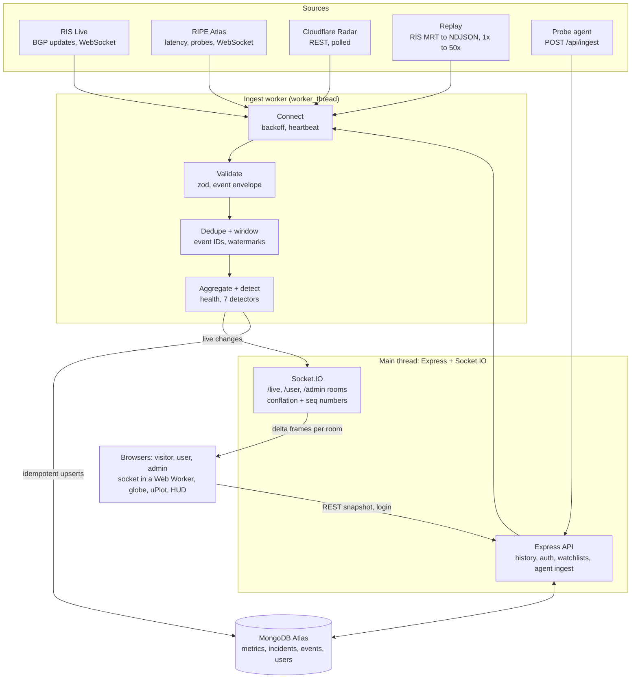

# Internet Nervous System — MERNIFY Hackathon Plan

> Snapshot of the team plan doc: https://claude.ai/artifact/2PbeaagNryMeTktuTwchj9 (exported 13 Nov 2026). If the doc changes, re-export it as Markdown and replace this file.

## Pitch and winning strategy

Internet Nervous System is a live 3D globe that watches the internet's routing, latency and attack signals as they happen. Within about a minute, it tells you where the internet is breaking and why.

**What a viewer sees:** a dark globe where countries glow by network health. Routing updates fire as pulses, and thousands of measurement probes show as dots coloured by latency. Attack flows are arcs between countries. When two or more independent signals agree, an incident card appears. Clicking a country or network opens its history flowing into live data. Logged-in users watch their own networks and get alerts.

**How it scores against the judging weights:**

| Criterion (weight) | What earns the marks |
| --- | --- |
| Functionality (30%) | Three real live sources plus historical replay, running the full ingest → process → store → broadcast loop |
| UX and design (20%) | The globe, incident cards that explain themselves, plain-language labels ("internet roads" instead of BGP jargon) |
| Technical (20%) | Event-time windows, deduplication, backpressure, per-country and per-network rooms, a snapshot-plus-delta merge protocol |
| Originality (20%) | Real internet telemetry, outage detection that combines several signals, a replay of the October 2021 Facebook outage |
| Presentation (10%) | Architecture doc, measured benchmarks, a scripted video that walks through every rubric item |

**Strategy in four rules:**

1. Every requirement and bonus point appears on screen at least once in the video (see the coverage matrix below).
2. Every performance claim is a number we measured, published in the README.
3. The detection moment is guaranteed: we replay a real historical outage on cue, so the demo doesn't depend on the internet breaking that day.
4. The app is hosted at a public URL that judges can open themselves.

**Assumptions:** a team of 2–4 people, deadline not yet known. The build plan is ordered so you can cut from the bottom.

## Rubric coverage matrix

Every line of the problem statement maps to a feature and to the moment in the video where judges see it. Timestamps refer to the video script below.

**Core requirements and technical guidelines**

| PDF requirement | How we meet it | Video |
| --- | --- | --- |
| Ingest continuous streams from multiple sources | RIS Live (routing), RIPE Atlas (latency and probe status), Cloudflare Radar (attacks, hijacks, leaks, outages), our own probe agent, historical replay | 0:40 |
| Process events and maintain system state | In-memory state per country, network (ASN) and prefix; health score per country and network, updated every second | 0:40 |
| Store telemetry for historical retrieval | MongoDB: 1-minute metrics, incidents, sampled raw events, probe and network metadata, with TTL limits | 1:20 |
| Broadcast updates in real time | Socket.IO pushes deltas to rooms per country, network and incident | 1:55 |
| Interactive visualisations | Globe, country and network drill-downs, incident timeline, live firehose view | 0:40 |
| History plus live, no duplicates or inconsistencies | Snapshot-plus-delta protocol with per-room sequence numbers; unique keys in MongoDB | 1:20 |
| Responsive under frequent updates | Server-side conflation, client batching per animation frame, windowed lists, chart point caps | 2:55 |
| Node.js + Express backend, MongoDB, React frontend | Express 5 API and ingest server, MongoDB Atlas, React with Vite | 3:40 |
| Socket.IO is integral | It is the only live channel to the browser; namespaces `/live`, `/user`, `/admin` | 1:55 |
| Batching, throttling or aggregation | 500 ms conflation windows, 1-second and 1-minute aggregates, sampled raw feed | 2:55 |
| Rooms or namespaces for subscriptions | Rooms `country:IN`, `asn:13335`, `incidents`, `user:<id>`; clients join by what is on screen | 1:55 |
| Events identify source, event and timestamp; handle duplicates and out-of-order | Common event envelope (source, event ID, event time, ingest time); dedupe keys; watermark windows with allowed lateness | 3:40 |
| Input validation and rate limiting | zod schemas on every upstream message, REST body and socket payload; token buckets per socket, per probe agent and per IP | 3:20 |
| Basic authentication and access control | JWT login; roles visitor, user and admin; per-namespace auth middleware | 3:40 |
| Clean UI with charts, maps and heatmaps | Globe with country heatmap, probe dots, attack arcs; uPlot time-series charts | 0:40 |

**Deliverables**

| Deliverable | Our plan |
| --- | --- |
| Working app with at least one data source | Three live sources, our own probe agent and a replay source, hosted publicly |
| Live dashboard and Socket.IO demo | The globe, plus a split-screen of three clients with different subscriptions |
| Historical retrieval merged with live | Time scrubber over the last 24 hours that hands over to live without gaps |
| GitHub README | Every required heading covered (checklist in its own section below) |
| Demo video, 3–5 min | Scripted at 4:30 (script below) |
| Optional architecture document | System diagram, data-flow diagram, schema, protocol, optimisation notes |

**Bonus points**

| Bonus point | Feature | Video |
| --- | --- | --- |
| High-frequency streams with low latency | Full RIS Live firehose; end-to-end latency measured from source timestamp to the browser (p50, p95) | 2:55 |
| Optimised payloads, selective broadcasting | Deltas only, compact arrays with a MessagePack parser, room-scoped emits, volatile emits for the raw feed | 2:55 |
| Client batching, throttling, windowing | Socket handling in a Web Worker, one render per animation frame, virtualised feed list, capped chart windows | 2:55 |
| Independent subscriptions and filters per client | Each client joins only the rooms in view, plus filters (withdrawals only, IPv6 only, minimum severity) | 1:55 |
| Historical analysis alongside live | Baselines from the same hour on previous days, incident history, 24-hour scrubber | 1:20 |
| Anomaly detection and alerts | Seven detectors, combined into scored incidents; toasts, a watchlist alert room, optional Discord webhook | 2:25 |
| Backpressure, rate limiting, protection from excess events | Bounded queues, adaptive sampling, slow-client downgrade, ingest API token bucket | 3:20 |
| Performance measurements and stress tests | Replay harness at 10× and 50×, Artillery Socket.IO load tests, a results table with events handled and clients connected | 2:55 |
| Hosting | One Docker Compose stack on an always-on VM behind Caddy (HTTPS), MongoDB Atlas; judges run the same stack locally with one command | 4:10 |

## Live data sources

The app uses three free public live feeds plus two sources we control. Only Cloudflare needs a key, and it is a free API token.

| Source | What it gives us | How we connect | Dedupe key | Role in the app |
| --- | --- | --- | --- | --- |
| [RIS Live](https://ris-live.ripe.net/) (RIPE NCC) | Every BGP routing update seen by RIPE's route collectors at internet exchanges, usually within a second | WebSocket `wss://ris-live.ripe.net/v1/ws/?client=<our-name>`, then a `ris_subscribe` message with filters (`host`, `type`, `require`, `path`, `prefix`, `moreSpecific`); the unfiltered firehose is at `/v1/stream/` | Message `id` (collector + peer + counter), with peer and timestamp as backup | Main high-volume stream: route churn, withdrawals, origin changes |
| [RIPE Atlas streaming](https://atlas.ripe.net/docs/apis/streaming-api/) | Ping and traceroute results from probes worldwide, plus probe connect and disconnect events | WebSocket `wss://atlas-stream.ripe.net/stream/` with `atlas_subscribe`; `streamType` `result` or `probestatus`; `sendBacklog` replays the last few minutes (only with an `msm` filter); `acceptedFields` trims fields server-side | (`msm_id`, `prb_id`, `timestamp`) | Latency per country and network; probes going offline |
| [Cloudflare Radar API](https://developers.cloudflare.com/radar/) | Layer 7 attack origin → target pairs (15-minute buckets), BGP hijack and route-leak events, outage annotations, traffic anomalies | REST, polled every 1–5 minutes with a free API token | Radar event `id` | Attack arcs; outside confirmation of our incidents |
| Historical replay ([RIS MRT archive](https://ris.ripe.net/docs/mrt/)) | BGP update files written every 5 minutes, going back years | Download `updates.YYYYMMDD.HHmm.gz` for the Facebook outage window, convert to NDJSON with `bgpkit-parser --json`, stream it through the same pipeline at 1×–50× | Same scheme as RIS Live | A guaranteed detection demo and input for stress tests |
| Our probe agent `ins-probe` | Ping and HTTP checks from teammates' laptops and the campus network | A small Node CLI that posts batches to `POST /api/ingest` with a per-device API key | (`deviceId`, `seq`) | Covers the PDF's "virtual devices and agents"; demonstrates validation and per-device rate limits |

**RIPE Atlas measurements to subscribe to** ([built-in list](https://atlas.ripe.net/docs/built-in-measurements/)). Every probe runs these automatically, so they give the widest coverage:

- IPv4 pings to the root DNS servers every 240 seconds, for example `1001` (k-root), `1008` (l-root), `1006` (m-root).
- IPv4 traceroutes to the root servers every 1,800 seconds (IDs 5000–6999, for example `5009` to a-root). Used later for the packet-path arcs.
- `probestatus` events for all probes, for the probe-disconnect detector.

**Reference data** (loaded once, refreshed daily, cached in MongoDB):

- Probe locations: the [Atlas probes API](https://atlas.ripe.net/docs/apis/rest-api-reference/probes/probes_list) is anonymous and returns each probe's coordinates, country, ASN and status.
- ASN and prefix → country: RIPEstat [country-resource-list](https://stat.ripe.net/docs/02.data-api/country-resource-list.html), called once per country. This is the country where a network is *registered*, and the UI labels it that way.
- ASN names: RIPEstat `as-overview`, fetched on demand and cached.

**The replay incident.** On 4 October 2021, Facebook (AS32934) withdrew the routes to its DNS servers. [ThousandEyes puts the burst of BGP withdrawals at about 15:39 UTC](https://www.thousandeyes.com/blog/facebook-outage-analysis), and [Cloudflare saw activity return around 21:00 UTC](https://segmentfault.com/a/1190000040772179/en). We replay 15:20–16:30 UTC from 3–4 collectors.

**Fine print**

- RIS Live asks clients to name themselves in the `client` query parameter.
- RIPE Atlas is retiring its Socket.IO streaming interface, so we use plain WebSocket. If our consumer falls behind, Atlas drops messages and sends one warning; we count these as an upstream-backpressure metric.
- [Radar data from the API is licensed CC BY-NC 4.0](https://ppc.land/cloudflare-radar/): fine for a hackathon, attribution required. RIS and Atlas data are credited to the RIPE NCC.
- We don't know the real event rates yet. Phase 0 measures them, and the measured numbers go in the README.

## System architecture and data flow



Everything sits behind one Caddy proxy (same origin): it serves the web build and forwards `/api` and `/socket.io` to the server.

Sources feed a worker thread that validates, deduplicates, windows and detects. The main thread only serves REST and Socket.IO, so a burst of events never stalls the UI. The probe agent's batches enter through the rate-limited `/api/ingest` endpoint before joining the pipeline.

## Stream processing

Every source is converted to one event format, deduplicated, grouped into windows by event time, and protected by bounded queues. Counts stay exact through reconnects, replays and overload.

**Event envelope.** Every event from every source looks like this:

```json
{
  "v": 1,
  "src": "ris",
  "eid": "ris:21-80-249-208-189-11187052#0",
  "kind": "bgp.withdraw",
  "ts": 1633362012345,
  "its": 1633362012601,
  "entity": { "asn": 32934, "prefix": "129.134.30.0/24", "cc": "US", "collector": "rrc10" },
  "data": { "peerAsn": 3356, "pathLen": 4 }
}
```

- `src`: `ris`, `atlas`, `radar`, `replay` or `agent`.
- `kind`: `bgp.announce`, `bgp.withdraw`, `bgp.peer_state`, `atlas.ping`, `atlas.trace`, `atlas.probe_status`, `radar.attack_pair`, `radar.hijack`, `radar.leak`, `radar.outage` or `agent.check`.
- `ts` is event time from the source; `its` is when our server received it. Their difference is the source-to-server latency we report.
- One RIS update can carry many prefixes. We split it into one event per prefix, numbered `#0`, `#1`, and so on.

**Pipeline stages**

1. **Connect.** One connector per source, with ping heartbeats, reconnects with exponential backoff and jitter, and automatic resubscription.
2. **Validate.** A zod schema per source message, plus a maximum message size. Rejected messages increment a counter, and a sample goes to a capped dead-letter collection.
3. **Normalise.** Convert to the envelope, then look up the country for each ASN and prefix in an in-memory table built from the reference data.
4. **Deduplicate.** An in-memory set of event IDs from the last 10 minutes catches most duplicates; unique indexes in MongoDB catch the rest. Atlas `sendBacklog` after a reconnect and restarted replays are the main sources of duplicates.
5. **Window by event time.** 1-second windows feed the live UI; 1-minute windows feed storage and detection. Each window has a *watermark* (latest event time seen minus an allowed lateness): about 5 seconds for BGP and 2 minutes for Atlas, because probes report in batches. A window closes once the watermark passes its end. Later events are counted as `late` and shown on the performance page.
6. **Aggregate state.** Per country and per ASN: announcements, withdrawals, distinct prefixes withdrawn, latency histogram (giving p50 and p95), probes up and down, and a health score from 0 to 100.
7. **Detect.** Detectors run on each closed window (next section).
8. **Persist.** Closed 1-minute windows are written as upserts holding the full computed values, never `$inc`, so writing the same window twice changes nothing.
9. **Publish.** Changes go to the broadcaster, which conflates them (next sections).

**Backpressure and overload** (starting thresholds, to be tuned in Phase 0):

- A bounded queue sits between each connector and the processor. Above 70% full, the raw feed shown to clients switches to sampling 1 in *k*, with *k* adjusting automatically. Aggregates are counted *before* sampling, so the numbers stay exact while the visual feed thins. The UI shows a "sampling 1 in k" badge.
- Above 95% full, we shed load in a fixed priority order: traceroutes first, then announcements from collectors nobody is viewing. Withdrawals and probe-status events are never dropped. Every shed event is counted.
- An event-loop delay monitor (`perf_hooks.monitorEventLoopDelay`) feeds the same controller.
- Processing runs in a `worker_thread`, so the main thread only serves HTTP and Socket.IO.
- Slow browsers are detected per socket and switched to 2-second summaries (Real-time delivery section).
- The agent ingest API has a token bucket per device and rejects oversized batches (Security section).

**Guarantee we state in the README:** counts are computed from deduplicated events before any sampling, and stored with idempotent upserts. Replaying, reconnecting or restarting never double-counts.

## Anomaly detection and incidents

Seven detectors each produce *signals*. An incident opens only when signals for the same network or country add up, which keeps false alarms low and gives every alert an explanation.

**Detectors** (thresholds are starting values, tuned on replayed data):

| Detector | Input | Method | Fires when |
| --- | --- | --- | --- |
| D1 Withdrawal storm | Withdrawals per origin ASN and per country, per minute | Robust z-score against a baseline: median and MAD over the last 60 minutes, plus the same hour yesterday once stored | z > 6 and at least 20 distinct prefixes withdrawn |
| D2 Origin change (possible hijack) | Origin ASN of each announced prefix | A table of known origins per prefix, learned during warm-up and seeded from history; also catches a more-specific prefix announced by a different origin | A new origin is seen by at least 2 peers on 2 collectors |
| D3 Latency surge | Atlas round-trip times, grouped by ASN and country | Smoothed (EWMA) baseline per probe | At least 30% of probes in a group (minimum 5) exceed 2× their baseline or lose every packet |
| D4 Probe dropout | Atlas `probestatus` disconnect events | Disconnects within 5 minutes, compared with connected probes in that group | At least 5 probes and at least 20% of the group |
| D5 Route flapping | Announce and withdraw cycles for one prefix | Flap count per prefix per 5 minutes | More than 10 flaps |
| D6 Cloudflare confirmation | Radar outages, traffic anomalies, hijacks, leaks | Polled and matched by ASN or country | Any new Radar event in scope |
| D7 Agent failures | Our probe agent's checks | Consecutive failures per target | 3 failures in a row |

**Combining signals into an incident**

- Signals are grouped by scope (ASN or country) within a sliding 10-minute window.
- Score = sum of signal weights, capped at 1.0: origin change 0.5, withdrawal storm 0.4, probe dropout 0.3, latency surge 0.2, flapping 0.1, Cloudflare confirmation +0.3, agent failures 0.1.
- Severity: *watch* below 0.5, *warning* from 0.5, *critical* from 0.8. Only warning and critical open an incident card.
- **Lifecycle:** open → updating (each new signal is added to its timeline) → resolving (all signals back within baseline for 10 minutes) → resolved.
- **Explanation:** generated from templates, not an LLM, so it's instant and always matches the data. For example: "AS32934 (Facebook) withdrew *n* prefixes in *m* minutes, *x* times its normal rate. *p* Atlas probes in this network lost reachability. Confirmed by Cloudflare Radar."
- **Delivery:** every incident is emitted to the `incidents` room and to its country and ASN rooms. Users whose watchlist matches get a toast in their `user:<id>` room, plus an optional Discord webhook.

**Historical analysis.** On startup, baselines are seeded from the stored 1-minute metrics for the last 24 hours. Detection is therefore accurate from the first minute, and each incident card shows the metric against the same hour yesterday.

**Proving it works** (results go in the README and video):

1. Replay the Facebook outage and measure the time from the first withdrawal to the incident card opening.
2. During the hackathon, log every Cloudflare outage annotation alongside our incidents. Report matches, which side detected first and by how much, and our false positives.

## MongoDB data model

Metrics use the *bucket pattern*: one document per scope per hour, holding a slot for each minute. Every collection that needs deduplication is a regular collection with a unique key. [Time-series collections don't support unique indexes](https://www.mongodb.com/docs/manual/core/timeseries/timeseries-limitations/), so they can't enforce the no-duplicates rule.

| Collection | Holds | Key and indexes | Retention |
| --- | --- | --- | --- |
| `metrics_hourly` | Per country or ASN per hour: `m.00`…`m.59`, each with announcements, withdrawals, prefixes withdrawn, RTT p50 and p95, probes up and down, health, late count | Unique (`scope`, `key`, `hour`); writes use `$set` on `m.<minute>`, so repeating a write changes nothing | TTL: countries 3 days, ASNs 2 days |
| `events_raw` | Sampled raw events, plus every event linked to an incident | `_id` = `eid` (unique for free); (`entity.asn`, `ts`), (`entity.cc`, `ts`) | TTL 6 hours (incident-linked events copied into the incident) |
| `incidents` | Scope, type, severity, score, state, timestamps, signal timeline, Cloudflare refs, summary | (`state`, `updatedAt`), (`scope`, `key`, `openedAt`) | Kept |
| `radar_events` | Cloudflare outages, anomalies, hijacks, leaks, attack-pair snapshots | `_id` = `radar:<type>:<id>` | TTL 30 days |
| `probes` | Atlas probe ID, coordinates, country, ASN, status, status since | `_id` = probe ID; `cc`; `asn` | Refreshed daily |
| `asns` | ASN name and registration country | `_id` = ASN | Cache, refreshed weekly |
| `prefix_origins` | Known origins per prefix, for the hijack detector | `_id` = prefix | Only watched or recently changed prefixes are saved; the full table stays in memory |
| `users` | Email, bcrypt hash, role | Unique `email` | Kept |
| `refresh_tokens` | Hashed refresh tokens | `userId`; TTL on `expiresAt` | 7 days |
| `watchlists` | A user's ASNs, countries, prefixes, minimum severity, optional Discord webhook | `userId` | Kept |
| `devices` | Probe-agent devices: owner, name, API-key hash, rate limit, last seen | `_id`; unique `keyPrefix` | Kept |
| `agent_checks` | Agent results | `_id` = `deviceId:seq` (unique) | TTL 24 hours |
| `ingest_stats` | Per source per minute: received, valid, rejected, duplicates, late, sampled out, shed, upstream drops, latency p50 and p95 | Unique (`src`, `t`) | TTL 7 days |
| `dead_letters` | Rejected messages, for debugging | Capped collection, 5 MB | Rolling |

**Storage budget on the free tier.** [Atlas M0 has a hard 512 MB limit](https://www.mongodb.com/docs/atlas/reference/faq/storage/) (data plus indexes), so the retention above is sized to fit. These are rough estimates; check them with `db.stats()` in Phase 0:

| Data | Estimate |
| --- | --- |
| Country metrics (about 250 countries, \~6 KB per hourly bucket, 3 days) | \~110 MB |
| ASN metrics (up to 300 ASNs with probes or on watchlists, 2 days) | \~90 MB |
| Sampled raw events (6 hours) | \~50 MB |
| Probes, ASNs, incidents, Radar, users, stats | \~40 MB |
| **Total** | **\~290 MB, leaving headroom** |

If the numbers come in higher, either run MongoDB in Docker on the backend VM (no cap) or move to the M2 tier. The pipeline doesn't change.

## Real-time delivery with Socket.IO

Clients receive only the rooms they are looking at, as small numbered delta frames. A snapshot-plus-delta handshake makes history and live data join with no gaps and no duplicates.

**Namespaces**

- `/live`: public and read-only, so visitors can use it without logging in.
- `/user`: requires a JWT. Carries personal alerts and saved filters.
- `/admin`: requires the admin role. Carries pipeline metrics and controls (replay start and speed, source toggles, detector thresholds).

**Rooms**

| Room | Carries | Update rate |
| --- | --- | --- |
| `world` | Global counters and per-country health changes | 1 per second |
| `country:<CC>` | Country metrics, its ASN list, probe RTT changes | 2 per second (500 ms conflation) |
| `asn:<N>` | Network metrics and prefix-level events | 2 per second |
| `incidents` | Incident open, update and resolve | Immediately |
| `arcs` | Cloudflare attack pairs | Each poll |
| `feed:<kind>:<cc>` | Sampled raw events for the firehose view | At most 20 per second per client, volatile |
| `user:<id>` (in `/user`) | Watchlist alerts | Immediately |
| `ops` (in `/admin`) | Ingest, queue, socket and latency metrics | 1 per second |

**Subscribing**

- The client sends `sub` with `{rooms, filters}` and an acknowledgement callback. The server validates it with zod, checks permissions, caps each socket at 20 rooms and rate-limits `sub`/`unsub` to 5 per second.
- The globe subscribes to the countries in view, 500 ms after the camera stops moving. Zooming from India to Europe swaps rooms automatically, so no client receives the whole world's detail.

**Payloads**

- Frames look like `{r: "country:IN", s: 1842, t: <ms>, d: [[key, field, value], …]}`: room, sequence number, server time, changes only.
- Conflation: within each 500 ms window only the latest value per key is kept. A value is sent only if it changed by more than a small epsilon (for example, health by at least 1 point).
- Binary encoding with `socket.io-msgpack-parser`, and `perMessageDeflate` only for messages over 1 KB (snapshots).
- The firehose uses `socket.volatile.emit`, so a busy client skips frames instead of queuing them.
- Payload bytes per client per second are measured and shown on the performance page, as JSON vs. MessagePack and with vs. without conflation.

**History plus live: the merge protocol**

1. The client joins a room. The server's acknowledgement returns that room's current sequence number, S0.
2. The client starts buffering frames for that room without rendering them.
3. The client calls `GET /api/history?scope=country&key=IN&from=…` and receives minute data from MongoDB, the last 15 minutes of 1-second points from server memory, and `snapshotSeq`, the last sequence number already included.
4. The client drops buffered frames with `seq` up to `snapshotSeq` and applies the rest in order.
5. If a frame skips a number, the client sends `resync`. The server replays the missing frames from a ring buffer of the last 120 frames per room, or sends a fresh snapshot.
6. The client stores points in a map keyed by timestamp, so even an overlap can't create a duplicate point.

We also enable Socket.IO's [connection state recovery](https://socket.io/docs/v4/connection-state-recovery/), which restores a client's rooms and missed packets after a short disconnection (2 minutes by default). The sequence check above confirms nothing was lost.

**Time scrubber.** Dragging into the past pauses rendering of live frames (they keep buffering) and loads that window. "Back to live" reruns steps 3–4 with the newest sequence number.

**Slow clients.** On each flush the server checks the socket's write buffer. If it is too full, that client gets 2-second summaries and no firehose until it catches up. These downgrades are counted on the performance page.

**Scaling out (stretch).** Run two server instances with `@socket.io/redis-adapter` and sticky sessions, and show in the load test that rooms keep working across instances.

## Frontend and visual design

The globe is the hero screen: one glance shows where the internet is healthy and where it is breaking. Every other page drills into one country, network or incident, with history flowing into live data.

**Pages**

| Page | What's on it |
| --- | --- |
| Globe `/` | Dark globe with countries coloured by health, probe dots coloured by RTT, routing-activity pulses per country, Cloudflare attack arcs, incident markers. Left: live events per second by source. Right: incident feed. Bottom: 24-hour time scrubber with a LIVE pill. Top: search (country, network, prefix) and layer toggles. A "What am I looking at?" overlay on first visit. |
| Country `/c/:cc` | Health score, latency chart (p50–p95 band, with a dashed line for the same hour yesterday), routing updates per minute (announcements vs. withdrawals), top networks with sparklines, probe list, incident history |
| Network `/asn/:asn` | Same layout, plus prefixes changing most, origin-change alerts, AS-path length trend |
| Incident `/incidents/:id` | Timeline of signals, scoped map, evidence charts, Cloudflare confirmation link, plain-language summary, "Replay this" for admins |
| Firehose `/feed` | The raw BGP stream as a virtualised list, with filters (type, country, network), pause, and badges for the event rate and sampling ratio |
| My network `/me` | Watchlist editor, alert rules, Discord webhook, probe-agent devices and API keys, alert history (login required) |
| Performance `/ops` | Ingest rate per source, queue depth, sampling ratio, late, duplicate and rejected counts, connected sockets, emits and bytes per second, event-loop delay, end-to-end latency p50/p95/p99, MongoDB writes per second, replay controls. Admin-only controls; a read-only view is public for judges. |

Press `~` on any page to toggle a HUD overlay with FPS, frames received per second, render time and dropped frames.

**Client-side performance**

- **Socket in a Web Worker** (via Comlink). The worker decodes MessagePack, applies deltas to its own store, and posts one merged update to the main thread per animation frame.
- **State in Zustand** with selectors, so a component re-renders only when its slice changes. `React.memo` on panels.
- **Render budget.** Globe layers update at most 10 times per second. Charts are uPlot (built for streaming time series), with one `setData` per frame and windows capped by ring buffers, for example 900 points for 15 minutes at 1-second resolution.
- **Virtualised lists** (TanStack Virtual) for the firehose, incident feed and network tables.
- **Instanced rendering** for thousands of probe dots: one three.js `InstancedMesh` instead of thousands of objects.
- **Hidden tabs.** When a tab is hidden (Page Visibility API), it leaves the heavy rooms and keeps only `world`, then rejoins on return.
- **History requests** go through TanStack Query, so revisiting a country is instant.

**Visual language**

- Dark theme. Health uses one sequential colour-blind-safe scale; red is kept for critical incidents only, so it always means something.
- Plain words first: "network" with the ASN in small type, "routes withdrawn" with a tooltip explaining BGP in one sentence. A 3-step onboarding tour.
- Responsive layout: on a phone, the globe on top and panels in a bottom sheet.

**Libraries:** React with Vite and TypeScript, react-globe.gl (three.js), uPlot, TanStack Query and Virtual, Zustand, Comlink, Tailwind CSS.

## Security: auth, access control, validation, rate limits

Anyone can watch without an account. Accounts add personal features, and the admin role controls the pipeline. Every input is validated and rate-limited, whether it comes from a browser, a probe agent or an upstream feed.

**Roles**

| Role | Can | Cannot |
| --- | --- | --- |
| Visitor (no login) | View the globe, countries, networks, incidents, firehose and the read-only performance page | Save anything; join `/user` or `/admin` |
| User | Everything above, plus watchlists, alert rules, a Discord webhook, and registering probe-agent devices | Use admin controls |
| Admin | Everything, plus replay controls, source toggles, detector thresholds, dead-letter viewer | — |

**Authentication**

- Email and password, hashed with bcrypt (cost 12).
- A 15-minute JWT access token kept in memory, plus a 7-day refresh token in an `httpOnly`, `Secure`, `SameSite` cookie. Refresh tokens rotate on use and are stored hashed. Logout revokes them.
- Sockets: `/user` and `/admin` run middleware that verifies the JWT sent in the handshake's `auth` field and checks the role. When a token expires, the client reconnects with a new one.
- The first admin is created from environment variables at startup.
- Probe-agent keys are 32 random bytes, shown once, stored as a SHA-256 hash with a short lookup prefix, valid only for `POST /api/ingest`, and revocable from `/me`.

**Validation.** One set of zod schemas in `packages/shared` covers REST bodies and query parameters, socket payloads, upstream messages and client forms. Unknown fields are stripped and sizes capped. Live events with timestamps more than a day from now are rejected (replay is exempt).

**Rate limits** (starting values)

| Surface | Limit | When exceeded |
| --- | --- | --- |
| REST, per IP | 100 requests per minute | 429 with `Retry-After` |
| Login and signup, per IP | 10 per minute; an account locks for 15 minutes after 5 failures | 429 / 423 |
| Socket connections, per IP | 20 per minute | Handshake refused |
| Socket messages (`sub`, `unsub`, `resync`), per socket | 5 per second (token bucket); 20 rooms maximum | Error event; disconnected if it repeats |
| Agent ingest, per device | 10 batches per second, 500 events per batch, 256 KB body | 413 if too large, 429 if too fast |
| Upstream feeds | Bounded queues with sampling and shedding | See Stream processing |

**Hardening:** helmet; web and API on one origin behind Caddy, with CORS locked to our own domain; `express.json({limit: '256kb'})`; Socket.IO `maxHttpBufferSize` of 64 KB; secrets only in environment variables; no stack traces in production; a least-privilege MongoDB user; structured pino logs with request IDs; an audit log of admin actions.

## Performance measurement and stress testing

Every performance claim in the README and video comes from built-in instrumentation and six repeatable tests. The numbers below are targets to aim for, not results.

**Instrumentation**

- **Server:** `prom-client` exposes `/metrics`, and the same values are saved per minute to `ingest_stats` for the `/ops` page. It records events in per source; rejected, duplicate, late, sampled-out and shed counts; queue depth; processing latency (receive → publish); connected sockets per namespace; emits and bytes out per room type; event-loop delay; MongoDB write time.
- **Client:** the HUD reports FPS, render time per frame, frames received per second and end-to-end latency. It sends a rate-limited summary to the server every 10 seconds. Client and server clocks are aligned with a ping-pong offset estimate, so latency figures are honest.

**Tests**

| Test | How | What we report |
| --- | --- | --- |
| T1 Ingest throughput | The replay harness pushes recorded NDJSON (30 minutes of live RIS and Atlas captured in Phase 0, plus the Facebook window) through the full pipeline at 1×, 10×, 50× and maximum speed | Sustained events per second before shedding starts, queue depth, sampling ratio, CPU, memory, event-loop delay p99 |
| T2 Fan-out | Artillery's Socket.IO engine, or a Node swarm using `socket.io-client`: 100, 500, 1,000 and 2,000 clients. 70% watch world plus one country, 20% three countries, 10% the firehose | Emits and bytes per second, delivery latency p50/p95/p99, CPU, memory, disconnects |
| T3 Soak | T1 at 10× plus T2 at 500 clients for 30 minutes | Memory stays flat, error counts, no leaks |
| T4 Client rendering | Chrome DevTools Performance plus the HUD, on a mid-range laptop, with the globe open during a 50× replay | FPS, long tasks, dropped frames |
| T5 Optimisation A/B | Same load with each optimisation toggled: JSON vs. MessagePack, conflation on vs. off, rooms vs. broadcast-to-all | Bytes per second per client and server CPU, as a before/after table and chart |
| T6 Chaos | Cut an upstream feed; drop a client's network for 30 seconds; restart the server mid-replay | Time to reconnect and resubscribe; sequence check passes after recovery; document count in MongoDB unchanged (no duplicates) |

**Targets** (to be confirmed by the tests):

- Server-side delivery latency p95 under 1 second (receive at our server → frame at the browser).
- At least 50 FPS on the globe during a 50× replay.
- 1,000 concurrent clients on one 2-vCPU VM.

Run the load generators from a second machine, so they don't compete with the server for CPU.

**Results table for the README** (filled in after the runs):

| Test | Configuration | Events/s | Clients | p50 | p95 | p99 | CPU | Memory |
| --- | --- | --- | --- | --- | --- | --- | --- | --- |
| T1 | 50× replay |  | — |  |  |  |  |  |
| T2 | 1,000 clients |  |  |  |  |  |  |  |
| T3 | 30 min soak |  |  |  |  |  |  |  |

## Tech stack, repo and deployment

The repo is a TypeScript monorepo: one server, one web app and one shared package of schemas. Everything ships as one Docker Compose stack. Judges run it with one command, and the same images run on an always-on server, because the ingest pipeline must never sleep.

**Stack**

| Layer | Choice |
| --- | --- |
| Runtime | Node.js 22 LTS, TypeScript, pnpm workspaces |
| API | Express 5 |
| Real-time | Socket.IO 4 with `socket.io-msgpack-parser`; `@socket.io/redis-adapter` as a stretch goal |
| Upstream clients | `ws` |
| Validation | zod, shared by server and client |
| Database | MongoDB Atlas (official Node driver) |
| Auth and limits | `jsonwebtoken`, `bcrypt`, `express-rate-limit`, our own token buckets |
| Observability | pino logs, `prom-client` metrics |
| Frontend | React, Vite, react-globe.gl, uPlot, TanStack Query and Virtual, Zustand, Comlink, Tailwind CSS |
| Testing | Vitest for pipeline units (dedupe, watermarks, detectors on fixtures), Artillery for load, Playwright smoke test (stretch) |
| Tooling | ESLint, Prettier, Docker Compose, GitHub Actions |

**Repo layout**

```
internet-nervous-system/
├─ CLAUDE.md                context for Claude Code
├─ apps/
│  ├─ server/
│  │  ├─ Dockerfile         multi-stage, non-root, HEALTHCHECK
│  │  └─ src/
│  │     ├─ index.ts        HTTP + Socket.IO bootstrap
│  │     ├─ api/            auth, history, incidents, watchlists, devices, ingest, ops
│  │     ├─ realtime/       namespaces, rooms, conflation, sequence numbers, slow clients
│  │     ├─ ingest/         worker-thread entry
│  │     │  ├─ sources/     ris, atlas, radar, replay
│  │     │  ├─ pipeline/    validate, normalise, dedupe, windows, aggregate, backpressure
│  │     │  └─ detect/      d1–d7 and fusion
│  │     ├─ db/             client, collections, indexes, repositories
│  │     ├─ auth/           JWT, bcrypt, middleware, roles
│  │     └─ metrics/        prom-client registry, ingest_stats writer
│  └─ web/
│     ├─ Dockerfile         Vite build copied into a Caddy image
│     └─ src/               pages, globe, charts, workers/socket.worker.ts, store, api
├─ packages/shared/         zod schemas, event envelope, room names, constants
├─ tools/
│  ├─ capture/              record live streams to NDJSON, measure rates
│  ├─ replay-prep/          MRT → NDJSON with bgpkit-parser
│  ├─ loadtest/             Artillery configs and a Node client swarm
│  └─ probe-agent/          the ins-probe CLI
├─ deploy/
│  ├─ Caddyfile             serves the web app, proxies /api and /socket.io
│  └─ seed/                 recorded history and replay files for the seed job
├─ docs/                    PLAN.md, problem statement, architecture, benchmark results
├─ docker-compose.yml       proxy, server, mongo, seed + profiles demo, loadtest, scale
├─ .env.example
└─ .github/workflows/       ci.yml, release.yml
```

**Deployment**

- **One stack everywhere.** `docker-compose.yml` defines `proxy` (Caddy: HTTPS, serves the built React app, forwards `/api` and `/socket.io` to the server), `server` (Express, Socket.IO and the ingest worker), `mongo` (local runs and judges only) and `seed` (runs once to load recorded history and replay files). Optional profiles: `demo` (replay mode, works offline), `loadtest` (Artillery), `scale` (Redis plus a second server).
- **Same origin.** The web app and API share one domain. The refresh cookie can be `SameSite=Strict`, Socket.IO needs no CORS, and the frontend uses relative URLs. Vite bakes environment variables in at build time, so keeping the API URL out of the build lets one image work locally and in production.
- **Server host:** an always-on VM. Size the RAM after measuring in Phase 0, with at least 2 GB. Avoid Render's free tier: [free services spin down after 15 minutes without inbound traffic](https://render.com/changelog/free-web-services-now-remain-active-while-receiving-websocket-messages), which would stop ingestion overnight. Options: Railway or Render paid plans, or a small VM; check the GitHub Student Developer Pack for cloud credits.
- **Database:** Atlas M0 in production through `MONGODB_URI`; the `mongo` container locally. If Atlas storage runs out, run the container on the VM too.
- **Images:** multi-stage Dockerfiles (`pnpm deploy` so only production dependencies ship), a non-root user, a `HEALTHCHECK` on `/healthz`, a `.dockerignore`, no secrets baked in. Built for `linux/amd64` and `linux/arm64` (many judges use Apple Silicon) and published to GitHub Container Registry.
- **For judges:** `cp .env.example .env`, then `docker compose pull`, then `docker compose --profile demo up`, then open `http://localhost:8080`. Caddy serves plain HTTP locally and HTTPS on the real domain. Live mode needs internet access; the Cloudflare token is optional, and its layer hides itself without one.
- **Health checks:** `/healthz` (process alive) and `/readyz` (MongoDB reachable and each source connected), plus an external uptime ping.
- **Secrets:** `.env.example` lists `MONGODB_URI`, `JWT_SECRET`, `CLOUDFLARE_API_TOKEN`, `ADMIN_EMAIL`, `ADMIN_PASSWORD`, `RIS_CLIENT_NAME`, `SITE_ADDRESS`, `MODE` (`live` or `replay`).
- **Day-to-day development stays outside Docker:** run `docker compose up mongo` for the database and `pnpm dev` natively, so hot reload stays fast.

**CI and Git**

- GitHub Actions on every pull request: lint, type-check, unit tests, build both apps, build the Docker images without pushing.
- On `main`: build multi-arch images with Buildx and push them to GitHub Container Registry, tagged with the commit SHA and `latest`. Then deploy over SSH with `docker compose pull && docker compose up -d`.
- A protected `main`, short-lived feature branches, small frequent commits. The PDF requires the repo to show work done during the hackathon, so the commit history is evidence too.

## Build plan

Phases in order (cut from the bottom if time runs short):

1. **Phase 0: Foundations and spikes.** Monorepo, CI, Docker Compose stack, shared contracts; MongoDB Atlas, Cloudflare token, server VM; capture tool (measure live rates, record 30 minutes of RIS and Atlas); convert the Facebook window to NDJSON.
   **Gate:** hello-world stack live on the server, rates measured, contracts frozen, replay files ready.
2. **Phase 1: Core loop (must-have; the app is submittable from here).** RIS and Atlas connectors, validate, dedupe, 1 s and 1 min windows, MongoDB upserts, /live rooms; globe with health and probes, history + live merge, JWT roles, rate limits, first deploy.
   **Gate:** live data on the hosted globe; history joins live with no gaps or duplicates.
3. **Phase 2: Detection and alerts.** Detectors D1–D4 and fusion, incidents and the incident page, Cloudflare poller and attack arcs; replay source, watchlists, /user alerts, Discord webhook.
   **Gate:** the Facebook replay opens a critical incident.
4. **Phase 3: Performance and protection.** Worker thread, backpressure and sampling, conflation, MessagePack, slow-client downgrade; client Web Worker, virtualised lists, /ops page and HUD, load tests T1–T6.
   **Gate:** results table filled with measured numbers.
5. **Phase 4: Polish and ship.** Onboarding overlay, probe agent CLI, detectors D5 and D7, README, architecture doc; video recorded and edited, demo accounts, pre-flight checklist.
   **Gate:** submitted (hosted app, repo, README, video).
6. **Stretch, only if time remains:** traceroute packet-path arcs, Redis adapter with two server instances, Playwright smoke test.

Build in this order and cut from the bottom if time runs short. After Phase 1, the app already meets every core requirement and can be submitted; each later phase adds bonus points.

**Team split** (for three people; with two, merge C into A and B; with four, split B into globe and pages)

| Workstream | Owns |
| --- | --- |
| A · Ingest and detection | Connectors, pipeline, windows, detectors, replay and capture tools |
| B · Real-time and frontend | Socket.IO layer, merge protocol, globe, pages, charts, client worker, HUD |
| C · Platform and proof | MongoDB schema, auth, rate limits, deployment, load tests, README, architecture doc, video |

**Phase 0 · Foundations and spikes**

- [x] Scaffold the pnpm monorepo (`apps/server`, `apps/web`, `packages/shared`, `tools/`) with strict TypeScript, ESLint and Prettier
- [x] Add `CLAUDE.md`, `docs/PLAN.md` and the problem statement PDF to the repo
- [x] Write the shared contracts in `packages/shared`: event envelope, room names, REST and socket payload schemas
- [x] Dockerfiles for server and web (multi-stage, non-root, health check) and a `.dockerignore`
- [x] `docker-compose.yml` with `proxy`, `server`, `mongo` and `seed`, plus the `demo`, `loadtest` and `scale` profiles; `deploy/Caddyfile`; `.env.example` *(done with `live` and `demo` profiles; `loadtest` arrives with Phase 3 and `scale` with the stretch goal, when there is something real to run in them)*
- [x] Hello world end to end: `docker compose up` serves the web app, which connects to Socket.IO through Caddy and shows a live heartbeat
- [x] CI: lint, type-check, test and build on pull requests; on `main`, build multi-arch images and push them to GitHub Container Registry
- [ ] Create MongoDB Atlas M0, a Cloudflare API token and the server VM; deploy the hello-world stack to the VM with HTTPS
- [x] Build the capture tool; measure real RIS and Atlas event rates and server memory; record 30 minutes to NDJSON
- [x] Convert the Facebook outage window to NDJSON with `bgpkit-parser` *(done with our own MRT reader in `tools/replay-prep` instead of bgpkit-parser, so regenerating needs only Node)*

**Phase 1 · Core loop**

- [x] RIS Live and Atlas connectors with reconnect and resubscribe
- [x] Validate, normalise, dedupe, 1-second and 1-minute windows with watermarks
- [x] `metrics_hourly` upserts and the history endpoint
- [x] `/live` namespace with `world` and `country:<CC>` rooms, sequence numbers and ring buffers
- [ ] Globe: country health and probe dots; country page with history merged into live
- [ ] JWT auth and roles, zod validation, REST and socket rate limits
- [ ] Deploy the full Compose stack to the server (Atlas for the database); write the README skeleton

**Phase 2 · Detection and alerts**

- [ ] Detectors D1–D4, fusion and the incident lifecycle
- [ ] Incident feed, incident page and templated summaries
- [ ] Cloudflare poller (D6) and attack arcs
- [ ] Replay source with speed control; check that the Facebook replay is detected
- [ ] Watchlists, `/user` alerts, Discord webhook

**Phase 3 · Performance and protection**

- [ ] Move ingest to a worker thread; bounded queues, sampling, shedding
- [ ] Conflation, MessagePack, volatile firehose, slow-client downgrade
- [ ] Client Web Worker, virtualised lists, render budget
- [ ] Metrics, the `/ops` page and the HUD
- [ ] Run load tests T1–T6 and fill in the results table

**Phase 4 · Polish and ship**

- [ ] Onboarding overlay and plain-language copy
- [ ] Probe agent CLI, detectors D5 and D7
- [ ] README and `docs/architecture.md` complete
- [ ] Record and edit the video; prepare demo accounts and the pre-flight checklist

## Demo video script and live demo plan

The video runs 4:30 and opens with the Facebook replay, so the most impressive moment lands in the first 20 seconds. Every rubric item has its own scene.

| Time | Scene | On screen | Rubric items shown |
| --- | --- | --- | --- |
| 0:00–0:20 | Hook | The Facebook outage replayed at 10×: AS32934's routes vanish from the globe, an incident card opens, Cloudflare confirmation appears | Anomaly detection, originality |
| 0:20–0:40 | Problem and pitch | Voice-over: outages are invisible until users complain; we watch three live signals of the internet's health | — |
| 0:40–1:20 | Live right now | The globe on live data with a UTC clock in the corner; events per second by source; layers toggled on in turn (routing pulses, probe dots, attack arcs); a glimpse of the firehose | Ingestion from multiple sources, processing, visualisations |
| 1:20–1:55 | History meets live | Open India: the 24-hour latency chart flows into live; drag the scrubber back 6 hours, then "Back to live"; a debug overlay shows continuous sequence numbers | Historical retrieval merged with live, no duplicates |
| 1:55–2:25 | Many clients, different views | Three browsers side by side: a visitor on India, a visitor on the US, a logged-in user with a watchlist. Each shows its own frame counter; the `/ops` page lists every socket's rooms | Rooms and namespaces, independent subscriptions, Socket.IO as the backbone |
| 2:25–2:55 | Detection explained | Open an incident: signal timeline, score, Cloudflare confirmation, plain-language summary. The user gets a toast and a Discord message | Anomaly detection and alerts, historical baselines |
| 2:55–3:20 | Performance under load | `/ops` and the HUD during a 50× replay: the sampling badge appears, FPS holds, queue depth stays flat; the JSON vs. MessagePack bytes comparison | High frequency, optimised payloads, client optimisations |
| 3:20–3:40 | Protection | The probe agent floods the ingest API: 429s appear, the rejected counter climbs, nothing else slows down; a malformed message is rejected | Validation, rate limiting, backpressure |
| 3:40–4:10 | Under the hood | Architecture diagram, the event envelope, watermarks, roles and auth | Technical implementation, authentication |
| 4:10–4:30 | Results and close | The benchmark table (events per second, clients, p95), the hosted URL, the repo | Stress-test results, hosting |

**Recording tips:** record each scene separately at 1080p 60 fps (OBS), with a written voice-over, cursor highlighting and captions, then edit. Keep the UTC clock visible in live scenes to prove the data is real.

**Live demo plan**

- **Pre-flight, one hour before:** `/readyz` green and every source connected; at least 24 hours of history in MongoDB; the replay file loaded; visitor, user and admin accounts ready in three browser profiles; the Discord channel open; the load generator ready on a second laptop.
- **If the venue internet fails:** run the whole stack locally with Docker Compose, using the replay source and our recorded capture of live traffic. Say clearly that it is recorded real data.
- **Q&A prep:** each teammate can explain watermarks, deduplication, conflation, why we don't use time-series collections, and how false positives are kept down.

## README and architecture document checklist

The README covers every heading the PDF requires, plus extras that make judging easy. `docs/architecture.md` wins the optional bonus.

**README: required by the PDF**

- [ ] Project overview and the problem it addresses
- [ ] Setup and execution instructions: one command with Docker Compose, plus manual steps
- [ ] Features implemented, mapped to the rubric
- [ ] Tech stack
- [ ] Data ingestion: the five sources, the event envelope, the replay and capture tools
- [ ] Real-time communication: namespaces, rooms, delta frames, the merge protocol
- [ ] How to run and test: unit tests, replay, load tests, the probe agent
- [ ] External libraries, APIs and resources with attribution: RIPE NCC (RIS Live, RIS raw data, RIPE Atlas, RIPEstat), Cloudflare Radar (CC BY-NC 4.0), and every npm library used

**README: extras**

- [ ] Live URL, video link and a 10-second GIF at the top
- [ ] Benchmark results table and the optimisation A/B chart
- [ ] Detection results: Facebook replay time-to-detect, comparison with Cloudflare
- [ ] Known limitations, stated honestly (registration country vs. physical location, sampling under overload)
- [ ] Team members and who built what
- [ ] A note on AI-tool usage (the PDF allows it; being open about it builds trust)

**`docs/architecture.md` (bonus)**

- [ ] System architecture diagram
- [ ] Data-flow diagram: ingestion → processing → storage → broadcasting
- [ ] Database schema with indexes and retention
- [ ] Real-time mechanism and the history-plus-live merge protocol
- [ ] Performance optimisations, with the measured effect of each
- [ ] Detection design: detectors, weights, lifecycle

## Risks and open questions

The biggest risk is depending on live upstream feeds during judging. The replay source removes it: the app behaves the same on recorded real data.

| Risk | Mitigation |
| --- | --- |
| An upstream feed is down or changes format during the demo | Replay and recorded capture as a drop-in source; reconnect with backoff; a source-health panel that shows status honestly |
| The full RIS firehose is too heavy for a small VM | Subscribe with filters (chosen collectors, `require`), process in a worker thread, adaptive sampling; measure in Phase 0 before committing |
| Free-tier limits (MongoDB's 512 MB, Render's spin-down) | Bucketed metrics with TTLs; an always-on server host |
| Country attribution is wrong (registration country isn't location; anycast) | Label it "registered in"; the latency layer uses probe coordinates, which are physical |
| False positives in detection | Incidents need several signals, thresholds are tuned on replay, confidence is shown, Cloudflare cross-check |
| Judges don't know BGP | Plain language, an onboarding overlay, the Facebook story as the hook |
| Scope creep | Phase gates in the build plan; cut from the bottom, never from Phase 1 |
| Cloudflare API limits | Poll every 1–5 minutes, cache, back off on errors |
| Clock skew distorts latency numbers | Ping-pong clock-offset estimate between client and server |
| Merge conflicts across a parallel team | Freeze the contracts (event envelope, room names, REST shapes) in `packages/shared` during Phase 0 |

**Open questions**

- [ ] What is the submission deadline, and is judging a live demo or video only?
- [ ] How many people are on the team, and who owns which workstream?
- [ ] Is there a budget or cloud credit for an always-on server?
- [ ] Does anyone have an Atlas or Cloudflare account already? (Both are free; the Cloudflare token takes 5 minutes.)

## Sources

- MERNIFY problem statement (project file `MERNIFY_ProblemStatement.pdf`)
- [RIS Live](https://ris-live.ripe.net/) and the [RIS Live message schemas](https://ris-live.ripe.net/schemas/v1/ris_subscribe.schema.json)
- [RIS raw data (MRT files)](https://ris.ripe.net/docs/mrt/) and [bgpkit-parser](https://github.com/bgpkit/bgpkit-parser)
- [RIPE Atlas streaming API](https://atlas.ripe.net/docs/apis/streaming-api/), [built-in measurements](https://atlas.ripe.net/docs/built-in-measurements/), [probes API](https://atlas.ripe.net/docs/apis/rest-api-reference/probes/probes_list)
- [RIPEstat country-resource-list](https://stat.ripe.net/docs/02.data-api/country-resource-list.html)
- [Cloudflare Radar outages](https://developers.cloudflare.com/radar/investigate/outages), [BGP anomalies](https://developers.cloudflare.com/radar/investigate/bgp-anomalies), [traffic anomalies](https://blog.cloudflare.com/traffic-anomalies-notifications-radar/), [data licence](https://ppc.land/cloudflare-radar/)
- [Socket.IO connection state recovery](https://socket.io/docs/v4/connection-state-recovery/)
- [MongoDB time-series limitations](https://www.mongodb.com/docs/manual/core/timeseries/timeseries-limitations/) and [Atlas storage limits](https://www.mongodb.com/docs/atlas/reference/faq/storage/)
- [Render free-tier spin-down](https://render.com/changelog/free-web-services-now-remain-active-while-receiving-websocket-messages)
- Facebook outage, 4 Oct 2021: [ThousandEyes](https://www.thousandeyes.com/blog/facebook-outage-analysis), [Catchpoint](https://www.catchpoint.com/blog/incident-review-for-the-facebook-outage-when-social-networks-go-anti-social)
