# Architecture

The design of Internet Nervous System: how data flows from the upstream feeds to the browser, how
it is stored, how live updates are delivered, how trouble is detected, and what each performance
optimisation measurably buys. Diagrams are Mermaid (GitHub renders them). Every number comes from
[`benchmarks.md`](benchmarks.md).

Contents

1. System architecture
2. Data flow: ingestion, processing, storage, broadcasting
3. Threads and the ingest link
4. Database schema
5. Real-time communication
6. Detection design
7. Security and access control
8. Performance optimisations and their measured effect
9. Failure handling

---

## 1. System architecture

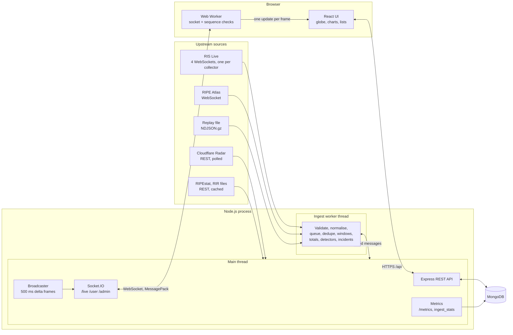

- **One Node.js process, two threads.** The ingest thread does the bursty per-event work and never
  touches the database or the browsers. The main thread serves HTTP, writes and reads MongoDB and
  delivers updates. They exchange typed messages (`apps/server/src/ingest/protocol.ts`).
- **One origin.** In production Caddy (or the server itself) serves the web app and forwards
  `/api` and `/socket.io`, so the browser uses relative URLs and needs no CORS.
- **Shared contracts.** `packages/shared` holds every schema both sides use: the event envelope,
  room names, frame format, socket payloads, REST responses. A change there breaks the type check
  on whichever side has not followed.

---

## 2. Data flow: ingestion, processing, storage, broadcasting

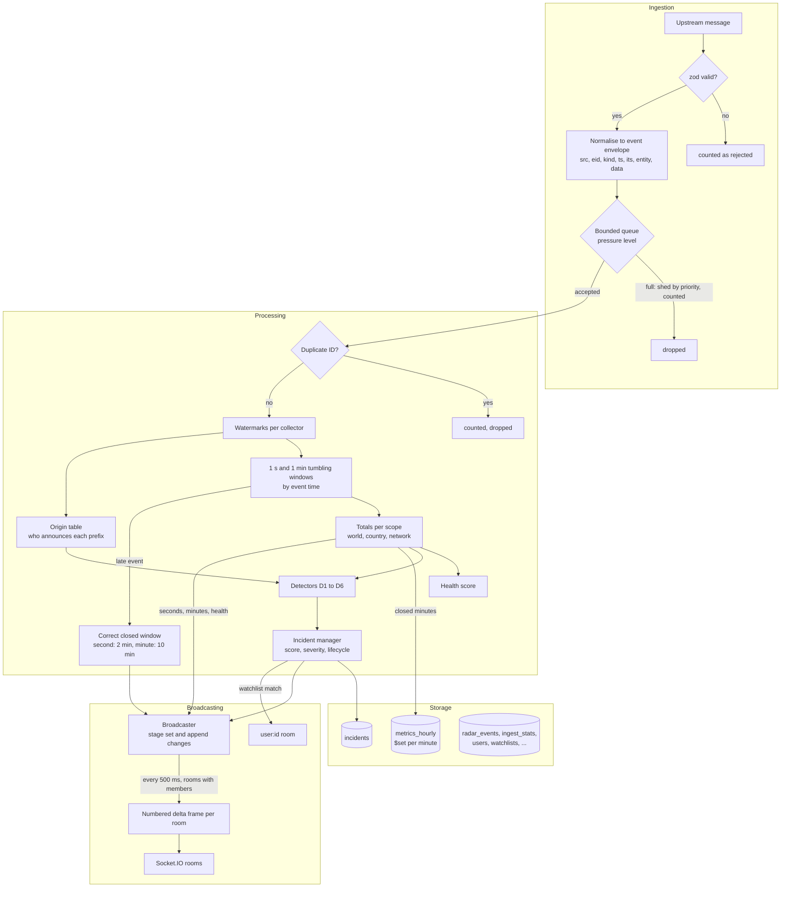

Step by step (code under `apps/server/src/ingest/`):

1. **Ingestion.** `sources/upstream-socket.ts` keeps each WebSocket alive (backoff with jitter,
   capped at 10 s; resubscribe; ping and idle watchdog). `sources/ris.ts` and `sources/atlas.ts`
   validate with zod schemas (`packages/shared/src/upstream.ts`) and normalise
   (`sources/normalise.ts`): one event per prefix for RIS, one per result for Atlas.
2. **Queue** (`pipeline/queue.ts`). Connectors only parse and hand over; the pipeline drains in
   8 ms slices. Pressure levels: below 70% normal; 70 to 95% the raw feed is sampled 1 in k; 95 to
   100% announcements are shed; 100 to 120% only withdrawals and probe status; above, overflow.
   The replay file waits instead of shedding.
3. **Dedupe** (`pipeline/dedupe.ts`): 48-bit hashes of message IDs in two 5-minute generations.
4. **Watermarks** (`pipeline/watermark.ts`): per collector, the slowest healthy partition's
   newest event time minus the allowed lateness (5 s routing, 240 s Atlas); partitions 15 s
   behind or 30 s silent are not waited for; future timestamps refused; never moves backwards.
   `complete()` also includes lagging partitions, for the "complete second" headline.
5. **Windows** (`pipeline/windows.ts`): tumbling, by event time. Closed windows accept late
   events (1-second windows for 2 minutes, 1-minute windows for 10) and are re-emitted as
   `amended`; an amended minute is written to MongoDB again with `$set` of its full totals.
6. **Totals and health** (`pipeline/aggregate.ts`, `packages/shared/src/health.ts`).
7. **Detection and incidents** (`detect/`), section 6.
8. **Storage** (main thread, `db/`): closed minutes, incidents, Radar events, per-minute stats.
9. **Broadcasting** (main thread, `realtime/`): section 5.

---

## 3. Threads and the ingest link

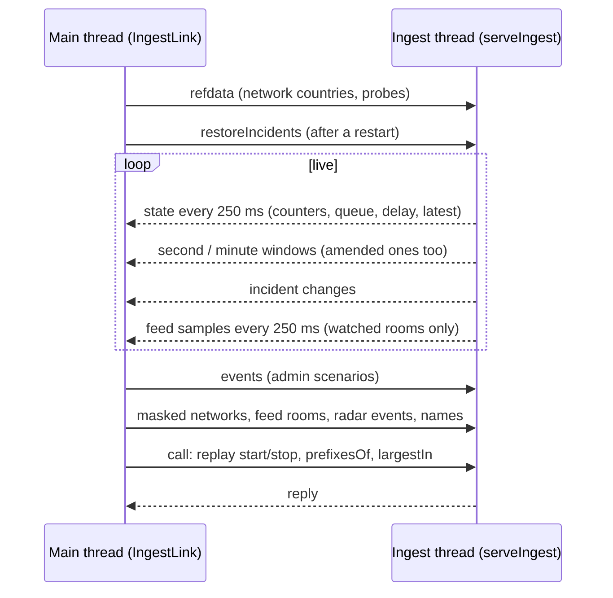

- Reads on the main thread are synchronous from a mirror refreshed four times a second; commands
  are messages; the few that need an answer are promise calls with a timeout.
- If the ingest thread dies it is restarted after 1 s; messages sent meanwhile are queued and
  delivered, and the new thread is given the reference data, the masked networks, the watched
  feed rooms and the known incidents again.
- `INGEST_THREAD=off` runs the same code in the main thread over a `MessageChannel` (tests).
- Measured at 90,000 events/s: main-thread response p99 0.35 ms with the thread, 1.21 ms without.

---

## 4. Database schema

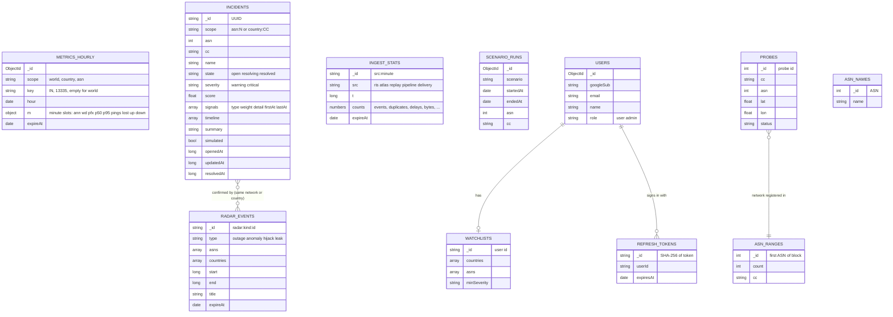

| Collection | Key and indexes | Retention | Why it exists |
|---|---|---|---|
| `metrics_hourly` | unique (`scope`, `key`, `hour`); TTL on `expireAt` | world 7 d, country 3 d, network 2 d (300 busiest) | History behind every chart; detector baselines after a restart |
| `incidents` | `_id` = UUID; (`state`, `updatedAt`), (`scope`, `openedAt`), `openedAt`, `updatedAt` | kept | The record of what was detected; restored after a restart |
| `radar_events` | `_id` = our ID (upsert); `start`; TTL | 30 d | Cloudflare reports for the panel, arcs and confirmation |
| `ingest_stats` | `_id` = `src:minute`; `t`; TTL | 7 d | The /ops history and benchmark evidence |
| `scenario_runs` | `_id` | kept | Shade simulated stretches on charts |
| `users` | unique `googleSub`, unique `email` | kept | Accounts (no passwords) |
| `watchlists` | `_id` = user ID | kept | What to alert each user about |
| `refresh_tokens` | `_id` = hash; `userId`; TTL on `expiresAt` | 7 d | Sessions, stored hashed, rotated on use |
| `probes`, `asn_ranges`, `asn_names`, `meta` | `_id` | refreshed daily / weekly / on demand | Reference data for countries and names |

Design decisions:

- **Bucket pattern.** One document per scope per hour with a field per minute: 60 times fewer
  documents and index entries than one per minute.
- **Idempotent writes.** Minutes are written with `$set` on their own fields (`m.07.ann`), never
  `$inc`; Radar events and stats rows are upserts on deterministic keys. A restart or replay that
  writes the same minute again changes nothing. Routing and latency fill the same minute separately
  (latency closes 4 minutes later) without overwriting each other.
- **Regular collections, not time-series**, because time-series collections cannot have unique
  indexes.
- **TTL indexes** keep the database under MongoDB Atlas M0's 512 MB.
- **What is not stored**: raw events (thousands per second; only aggregates and incidents are kept),
  passwords, and Cloudflare's attack pairs (recomputed by Cloudflare every 15 minutes, held in
  memory).

---

## 5. Real-time communication

### Namespaces and rooms

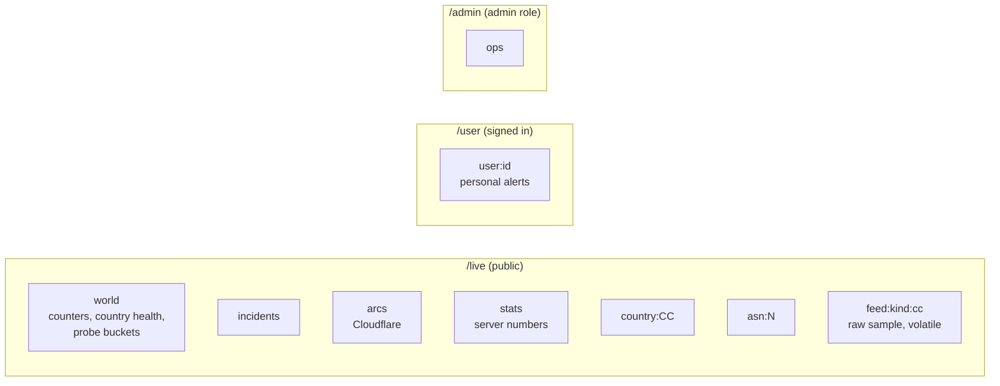

A socket receives nothing until it joins rooms (`sub`, validated with zod; at most 20 rooms, one
feed room). `/user` and `/admin` verify the access token in the handshake before accepting the
connection.

### Frames

```json
{ "r": "country:IN", "s": 42, "t": 1794565823000, "d": [["now", "health", 97], ["s:1794565822000", "bgp", {"ann": 34, "wd": 5, "pfx": 2}]], "f": 39 }
```

`r` room, `s` sequence number (+1 per frame per room), `t` server time, `d` changes as
`[key, field, value]`, `f` only on a slow-client summary (it covers frames `f` to `s`). The
broadcaster (`realtime/broadcaster.ts`) stages **set** changes (current values; sent only if
changed beyond a tolerance) and **append** records (unique keys), and flushes one frame per room
every 500 ms, only for rooms with members, keeping the last 120 frames per room.

### Joining and merging history with live data

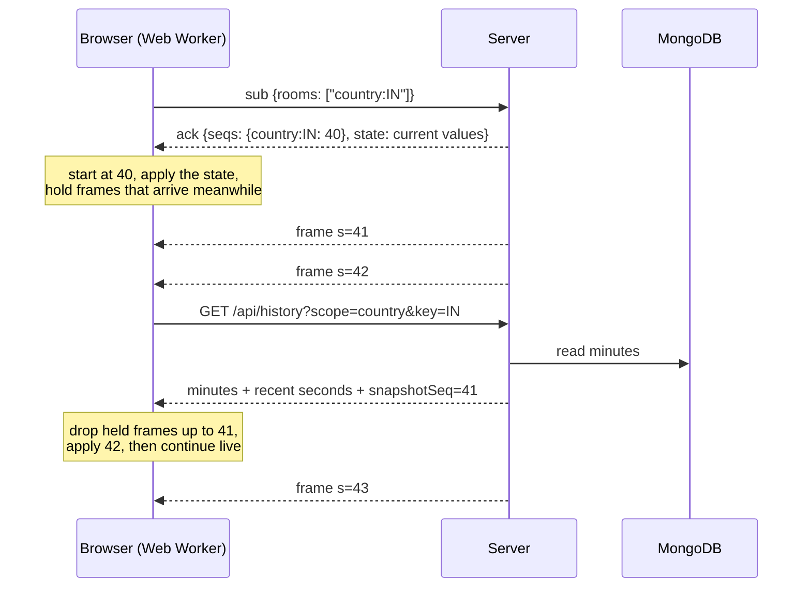

Points are stored by timestamp in the browser, so an overlap replaces instead of duplicating.

### Gaps, duplicates and recovery

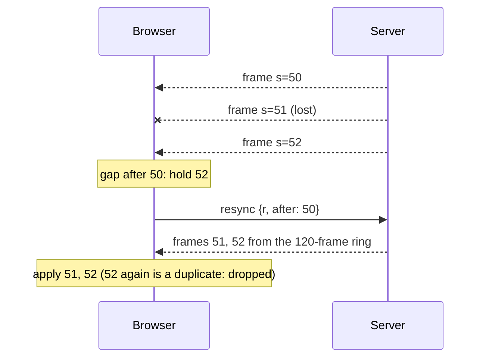

- Ring buffer exhausted: the server answers `gap_too_old` and the browser reloads the room's
  history.
- Short network drops: Socket.IO connection-state recovery restores the rooms and re-sends missed
  packets (up to 2 minutes; measured: offline 30 s, back in 13 ms, no gap). Longer: the browser
  rejoins and starts from fresh sequence numbers.

### Slow clients

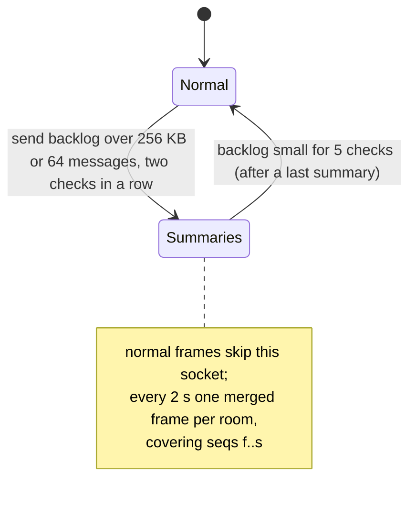

### Raw feed

The ingest thread samples only rooms with viewers: every matching event is counted, and a fair
**reservoir sample** of at most 5 per quarter second (20/s) is kept per room, thinned further by
the queue's 1-in-k under pressure. Batches go out **volatile**: a client that cannot take one now
misses it.

### Client side

The socket runs in a **Web Worker** (decoding, sequence checks, holding frames). The page applies
the worker's updates merged once per animation frame (one store update, at most one React render),
once a second when hidden; the globe skips rebuilds while hidden; long lists are virtualised. The
HUD (`~`) measures frames drawn and skipped, update cost, long tasks and frame age corrected by a
clock offset from `/api/time`.

---

## 6. Detection design

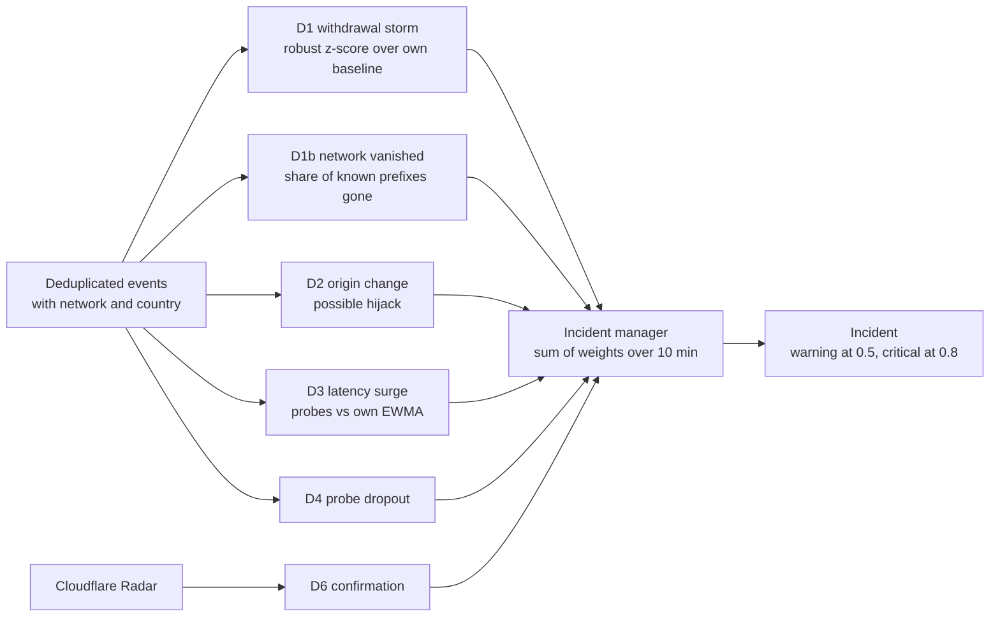

| Detector | Fires when | Weight |
|---|---|---|
| D1 withdrawal storm | robust z (median and MAD of its own minutes) > 6, 20+ prefixes, 5+ routers, 10 min of history | 0.4 (+0.1 widespread, +0.1 extreme) |
| D1b network vanished | 15%+ of known prefixes (15+) withdrawn by 20+ routers each, not re-announced | up to 0.6 (full at 40%) |
| D2 possible hijack | new origin for a prefix at 3+ collectors, old owner not on the path | 0.3 + 0.05 per prefix (up to 6) |
| D3 latency surge | 30%+ of a country's probes (5+) degraded on all their targets | 0.2, up to +0.3 with 20+ probes |
| D4 probe dropout | 5+ disconnects in 5 min, 20%+ of connected probes | 0.3, up to +0.3 with the share |
| D6 Cloudflare | a current Radar report for the same network (or country, for outages and anomalies) | 0.3, never alone |

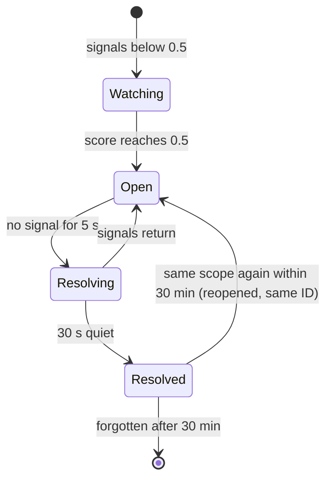

- Severity follows the score: warning from 0.5, critical from 0.8; the peak is kept.
- Summaries are built from templates with the evidence; names from RIPEstat.
- Baselines are reloaded from `metrics_hourly` at startup; recent incidents are handed back
  to the manager so an outage continuing across a restart reopens its incident.
- Live traffic for a network a simulation is faking is kept out of detection while it runs.
- Tuning on a 30-minute live recording brought 19 incidents down to 4 explainable ones.

---

## 7. Security and access control

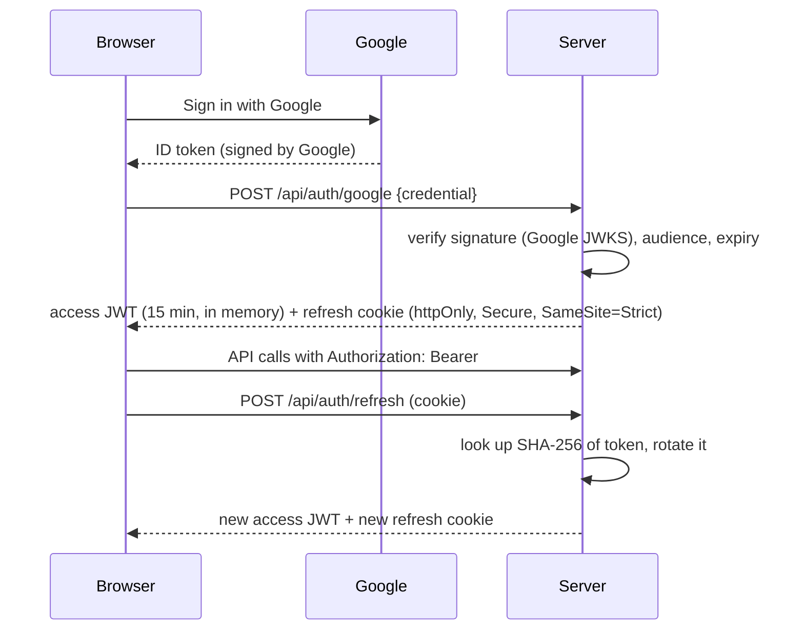

- Roles: visitor (everything public), user (watchlist, personal alerts), admin (simulations,
  replay, `/metrics`). Private namespaces check the token during the Socket.IO handshake.
- Validation: zod on every upstream message, REST input and socket payload; 64 KB maximum socket
  message.
- Rate limits: REST 100/min per IP; sign-in 10/min per IP; new sockets 20/min per address; `sub`,
  `unsub`, `resync` a token bucket of 5/s per socket (persistent offenders disconnected).
- helmet security headers; secrets only in environment variables; non-root Docker images.

---

## 8. Performance optimisations and their measured effect

| Optimisation | Where | Measured effect |
|---|---|---|
| Ingest in a worker thread | `ingest/worker.ts`, `link.ts` | main-thread p99 0.35 ms vs 1.21 ms at 90k events/s |
| Bounded queue with sampling, shedding, file backpressure | `pipeline/queue.ts` | 1.35M events/s with no shedding; forced overload sheds announcements first or pauses the file, nothing lost silently |
| Hashed, generational dedupe | `pipeline/dedupe.ts` | fixed memory per message; bounded growth in the 30-min soak |
| Event-time windows with watermarks and corrections | `pipeline/` | exact counts; headline matched final totals in 29 of 29 checks; 4.5% of events corrected into their second; minute corrections recover the 2.8% that used to miss their minute |
| Delta frames (set and append) | `realtime/broadcaster.ts` | only changed values travel |
| Conflation (500 ms per room) | `realtime/broadcaster.ts` | without it: x3.6 bytes per client, 67 frames/s instead of 2.6, main loop up to 188 ms |
| Rooms instead of broadcast to all | `realtime/` | broadcast to all: x1.5 bytes in T5 (more with more distinct rooms) |
| MessagePack | `socket.io-msgpack-parser` | 40% fewer bytes on live data, 29% in T5 |
| Joiner state in the `sub` ack | `realtime/live.ts` | removes a re-send of ~278 KB to every viewer per page load (was quadratic in clients) |
| Sampled, volatile raw feed | `ingest/feed.ts` | at most 20 events/s per viewer whatever the input rate |
| Slow-client summaries | `realtime/slow.ts` | one merged frame per room every 2 s for a lagging client |
| Socket in a Web Worker; one render per frame; virtual lists | `apps/web` | 500-row list with 20 rows in the DOM; update cost under 2 ms |
| Upstream backoff ceiling 10 s | `sources/upstream-socket.ts` | feed back 8.2 s after a network cut (18.5 s before) |

Fan-out (T2): 2,000 clients, 0 gaps, delivery p99 62 ms with the load generator on the same
machine; about 2 KB/s per client independent of client count.

---

## 9. Failure handling

| Failure | What happens | Measured |
|---|---|---|
| Upstream connection drops | reconnect with backoff and jitter, resubscribe; other sources carry on | feed back 8.2 s after the network returns |
| A collector lags | not waited for after 15 s; its events correct their second (for 2 min) and their stored minute (for 10 min) | before minute corrections, 2.8% of events missed their minute (756,018 of 26 million over 479 minutes); now only events over 10 min late do |
| Duplicate or replayed events | dropped by the deduper; idempotent writes | 0 duplicate documents after `kill -9` |
| Browser misses frames | `resync` from the ring buffer, or history reload | 0 gaps across every load test |
| Browser offline briefly | connection-state recovery | 30 s offline: back in 13 ms, no gap |
| Slow browser | 2-second summaries | covered by tests |
| Server killed | restart; clients reconnect and rejoin; baselines and incidents restored from MongoDB | answering in 0.27 s; 50 clients back in 0.79 s |
| Ingest thread crashes | restarted after 1 s with its inputs re-sent | covered by tests |
| Overload | sample, then shed by priority, then overflow; all counted | never reached outside forced tests |
