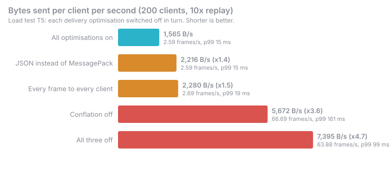

# Benchmarks

**Live app:** [internet-nervous-system-production-ef768d52.up.railway.app](https://internet-nervous-system-production-ef768d52.up.railway.app/) · **Demo video:** [YouTube](https://www.youtube.com/watch?v=Uykt0FJTCIA)

Every number here was measured, with the command that produced it. Nothing is estimated.

## Phase 0 measurements: real upstream event rates

**Run:** 13 Nov 2026, 08:47–08:57 UTC, 600 seconds. `pnpm capture --minutes 10 --no-record`
(`tools/capture`). MacBook (darwin/arm64), Node v22.23.5, home connection measured at about
9 MB/s download. All three streams ran at the same time in one process.

### Rates

| Stream | Subscription | Messages/s (avg) | Messages/s (peak 10 s) | Events/s (avg) | Events/s (peak 10 s) | KB/s | Largest message |
| --- | --- | --- | --- | --- | --- | --- | --- |
| `ris-full` | RIS Live, all collectors, all types | 674.3 | 1,515.3 | 1,835.1 | 7,451.9 | 308.0 | 18,862 B |
| `ris-filtered` | RIS Live, collector `rrc00`, UPDATE only | 538.3 | 2,263.3 | 1,464.6 | 7,887.7 | 229.2 | 18,862 B |
| `atlas` | Atlas pings 1001, 1008, 1006 + probe status | 179.1 | 222.8 | 179.1 | 222.8 | 75.7 | 22,918 B |

"Events" counts one per prefix: a RIS UPDATE that announces or withdraws several prefixes becomes
several events in our pipeline. On average one RIS message carried 2.7 prefixes.

Totals: `ris-full` 404,610 messages (401,774 UPDATE, 2,091 KEEPALIVE, 707 STATE, 25 OPEN,
13 NOTIFICATION) from 23 collectors. `atlas` 107,281 ping results, 95 probe connects, 82 disconnects.

### Validation

| Stream | Messages | Failed schema | Not JSON | Upstream warnings |
| --- | --- | --- | --- | --- |
| `ris-full` | 404,610 | 0 | 0 | 0 |
| `ris-filtered` | 322,993 | 0 | 0 | 0 |
| `atlas` | 107,458 | 0 | 0 | 0 |

The zod schemas in `packages/shared/src/upstream.ts` accepted every one of 835,061 real messages.

### Lag (our receive time minus the message's own timestamp)

| Stream | p50 | p95 | p99 | Reconnects in 10 min |
| --- | --- | --- | --- | --- |
| `ris-full` | 35.7 s | 69.7 s | 83.8 s | 7 |
| `ris-filtered` | 35.7 s | 84.3 s | 84.3 s | 8 |
| `atlas` | 69.7 s | 135.7 s | 1,470.7 s | 0 |

### Capture process

| Peak RSS | Peak heap | Average CPU (one core = 100%) | Event-loop delay p99 | Event-loop delay max |
| --- | --- | --- | --- | --- |
| 116 MB | 20.5 MB | 3.8% | 11.75 ms | 20.46 ms |

This is the cost of receiving, parsing, validating and counting only. It is a floor for the server,
not a prediction of it.

### What the numbers tell us

1. **A busy RIS Live subscription falls behind and gets disconnected.** Both RIS connections showed
   the same cycle: lag climbed steadily to about 84 seconds, the server closed the connection
   (WebSocket code 1006), we reconnected, and it started again. That happened 7 and 8 times in ten
   minutes. Our process was not the bottleneck (3.8% CPU, 12 ms event-loop delay p99, a 9 MB/s line
   carrying about 0.6 MB/s). *(Correction, Phase 3 step 5: the capture tool sampled the event loop
   every 10 ms and Node includes that interval in the reading, so the real delay was about 2 ms.)*
2. **The unfiltered stream is not complete.** In the same ten minutes the unfiltered connection
   delivered 47,564 messages from `rrc00`; the connection filtered to `rrc00` delivered 322,993.
   The unfiltered stream therefore carried about 15% of that collector's messages.
3. **Each connection seems to deliver roughly 500–700 messages per second.** Two 60-second follow-up
   tests with single-collector filters (`rrc00`, `rrc21`) delivered 485 and 498 messages per second.
   In one of them lag stayed near 4 seconds; in the other it grew to 32 seconds.
4. **RIS Live was partly unhealthy during the run.** Connection attempts were answered with
   HTTP 502 several times. We do not know yet whether points 1–3 are normal behaviour or a
   bad day. This needs a second run on another day before we rely on it.
5. **Atlas is steady and slow by design.** About 180 results per second with no reconnects and no
   warnings. Half of the results are more than 70 seconds old when they arrive and 5% are more
   than 136 seconds old, because probes report in batches. One result was 6.9 days old.
6. **Some Atlas timestamps are in the future.** At least one probe reported a time hours ahead of
   ours, which made almost every later result look late in this run's ordering statistics. The
   capture tool now sets such messages aside and counts them (`futureTimestamps`). Atlas ordering
   numbers from this run are therefore not reported; see the 30-minute run below.

### Consequences for Phase 1

- Do not subscribe to the unfiltered firehose. Open several RIS connections with narrow filters
  (per collector, and by message type) and keep each one under the rate it can sustain.
- Measure lag per connection continuously and treat rising lag as upstream backpressure: it is the
  early warning before a disconnect.
- Reconnect logic is not optional. It ran 15 times in ten minutes here.
- The watermark must ignore timestamps ahead of the server clock, or one bad probe stalls or
  corrupts every window.
- The plan's allowed lateness for Atlas (2 minutes) is close to the measured p95 (136 s); about 5%
  of results would arrive after their window closed. Either widen it to about 3 minutes or accept
  and count those as late.
- RIS ordering inside a connection: 97.7% of messages on the unfiltered stream were older than one
  already seen (collectors interleave), by 1.3 s at the median and 4.0 s at p99. The plan's
  5-second lateness for BGP covers that.

## Phase 0 recording: 30 minutes of real traffic

**Run:** 13 Nov 2026, 08:59–09:29 UTC, 1,800 seconds. `pnpm capture --minutes 30`, same machine.
This run also wrote the recordings used for replay and stress tests, and `tools/replay-prep` ran on
the same machine for part of it.

| Stream | Messages | Messages/s (avg) | Events/s (avg) | Events/s (peak 10 s) | Lag p50 | Lag p95 | Lag p99 | Reconnects | Failed schema |
| --- | --- | --- | --- | --- | --- | --- | --- | --- | --- |
| `ris-full` | 1,005,394 | 558.5 | 1,432.5 | 3,708.1 | 43.2 s | 92.7 s | 180.7 s | 23 | 0 |
| `ris-filtered` (`rrc00`) | 1,101,620 | 612.0 | 1,386.7 | 4,841.3 | 4.0 s | 32.5 s | 149.3 s | 4 | 0 |
| `atlas` | 320,641 | 178.1 | 178.1 | 296.4 | 69.7 s | 123.4 s | 198.7 s | 0 | 0 |

Process: peak RSS 113.6 MB, peak heap 24.6 MB, average CPU 6.2% of one core (this run also
gzipped two files), event-loop delay p99 11.8 ms, max 40.4 ms. Memory stayed flat for 30 minutes.

Recorded files (not committed; regenerate with the command above):

| File | Size | Contents |
| --- | --- | --- |
| `deploy/seed/capture/ris-full-20261113T085859Z.ndjson.gz` | 33.0 MB | 1,005,394 RIS messages |
| `deploy/seed/capture/atlas-20261113T085859Z.ndjson.gz` | 19.0 MB | 320,641 Atlas messages |

### What the longer run adds

1. **The filter is what keeps a RIS connection healthy.** The connection filtered to one collector
   had a median lag of 4.0 seconds and 4 reconnects in 30 minutes. The unfiltered one had a median
   lag of 43.2 seconds and 23 reconnects. This confirms the first run's conclusion with three times
   the data, though still on the same day.
2. **The unfiltered stream is a thin sample.** It delivered 97,825 messages from `rrc00` while the
   filtered connection delivered 1,101,620: about 9%.
3. **One collector alone is about as much as one connection carries.** `rrc00` averaged 612
   messages per second (1,387 events per second) and still lagged at times (p95 32.5 s).
4. **Atlas lateness, measured properly this time.** 727 results (0.23%) carried timestamps more
   than a minute ahead of our clock and were set aside. Of the rest, a result arrived a median of
   102 s behind the newest timestamp already seen, 164 s at p95 and 240 s at p99. An allowed
   lateness of 2 minutes would mark roughly half of Atlas results as late; **about 4 minutes
   covers 99%.** The plan's 2-minute figure needs to change.
5. **Schemas held.** All 2,427,655 messages in this run passed validation.

## Phase 0: Facebook outage replay file

`pnpm replay-prep` (13 Nov 2026). RIS update files for 4 Oct 2021, 15:20–16:30 UTC, collectors
`rrc05`, `rrc10`, `rrc11`, `rrc14`. Full per-minute data is in
`deploy/seed/replay/facebook-20211004.summary.json`.

| Measure | Value |
| --- | --- |
| MRT records read | 3,196,459 (0 malformed, 19,349 skipped as not updates) |
| Events written | 8,569,494 (7,536,132 announcements, 1,028,937 withdrawals, 4,425 peer state changes) |
| Output size | 88.6 MB gzipped |
| Average rate at 1× | about 2,040 events per second (8,569,494 events over 70 minutes) |
| AS32934 prefixes seen announced | 175 |
| AS32934 withdrawals per minute, 15:20–15:39 | 0 in every minute except 15:30 (2) |
| First AS32934 withdrawals of the burst | 15:40 UTC (12 withdrawals, 3 prefixes) |
| First minute with at least 20 AS32934 prefixes withdrawn | 15:42 UTC (378 withdrawals, 25 prefixes) |
| Peak minute | 15:43 UTC (769 withdrawals, 27 prefixes) |

Withdrawals are attributed to AS32934 only for prefixes the tool had already seen announced by it
in this window, so these counts are a lower bound.

## Phase 1: storage, first measurements

**Run:** 13 Nov 2026, about 10:23–10:33 UTC, `pnpm dev` with the Docker `mongo:8` container, four RIS
collectors and three Atlas measurements. Collection sizes from `db.<collection>.stats()`.

| Collection | Documents | Data | Storage (compressed) | Indexes |
| --- | --- | --- | --- | --- |
| `asn_ranges` | 103,403 | 4.83 MB | 1.14 MB | 1.09 MB |
| `probes` | 17,910 | 1.63 MB | 0.57 MB | 0.20 MB |
| `metrics_hourly` (after about 6 stored minutes) | 848 | 0.13 MB | 0.07 MB | 0.13 MB |

- Reference data: the first download (five registry files plus 36 pages of probes) took about
  40 seconds; later restarts load it from MongoDB.
- One minute of routing touched the world, 104 countries and 579 networks (the 300 busiest are
  stored per family per minute). A bulk write of one minute's documents took 9–28 ms.
- Pipeline over the run: 235,977 events received, 235,602 counted, 3 duplicates dropped, 316 late,
  56 with timestamps from the future.

`metrics_hourly` will grow with every hour until its TTLs start deleting. **Not yet measured:** its
size after a full hour and after the 2–3 day retention. That decides whether MongoDB Atlas M0
(512 MB) is enough; re-measure after a long run before deploying.

## Phase 1: live rooms

**Run:** 13 Nov 2026, `pnpm dev` on live data (four RIS collectors, three Atlas measurements). One
Socket.IO client subscribed to `world`, `country:US`, `country:BR` and `country:DE` for 75 seconds,
then fetched `GET /api/history` for the same rooms. JSON encoding (MessagePack comes in Phase 3).

| Room | Frames | Frames/s | Gaps | Bytes/s | Deltas per frame | 1 s points overlapping history | Mismatches |
| --- | --- | --- | --- | --- | --- | --- | --- |
| `world` | 103 | 1.4 | 0 | 0.93 KB | 32.0 | 75 | 0 |
| `country:US` | 70 | 0.9 | 0 | 0.10 KB | 1.1 | 75 | 0 |
| `country:BR` | 70 | 0.9 | 0 | 0.10 KB | 1.1 | 75 | 0 |
| `country:DE` | 70 | 0.9 | 0 | 0.10 KB | 1.1 | 75 | 0 |

Every 1-second point that arrived live and also appeared in the history response had identical
values. `resync` for the last three frames of `country:US` returned exactly frames 68, 69 and 70.

## Phase 2: detection

**Tuning run:** the 30-minute recording of 13 Nov 2026 (`ris-full-*.ndjson.gz`, sampled firehose)
replayed through the real pipeline, detectors and incident manager on its own clock (about 20 s of
CPU). First thresholds opened 19 incidents, mostly small networks whose few known prefixes flapped
(after a restart we only know prefixes seen since start). Requiring 20 different routers to withdraw
a prefix before it counts as gone, 20 routers reporting, 3 collectors for a new origin, and reopening
an incident instead of opening a new one brought it to **4 incidents**, all warnings: two possible
hijacks (6 and 31 prefixes at a new origin, 13 and 5 collectors) and two small networks whose every
known prefix was withdrawn by 29–32 routers.

**Facebook scenario (recorded data, 10×):** in the test on a simulated clock a critical incident for
AS32934 opens 12.7 s after the first withdrawal and resolves after the simulated recovery. Live
(13 Nov 2026, dev server): the incident opened 24 s after the trigger, with 1,735 withdrawals in a
minute seen by 105 routers.

**Attack simulator, live (14 Nov 2026):** country blackout on DE (its three largest networks in our
table, every German Atlas probe): AS29066, AS8881 and AS60664 critical **4.2 s** after the trigger
(storm + vanished), `country:DE` critical **5.2 s** after (storm + latency + dropout).

## Phase 2: Cloudflare Radar

First poll (14 Nov 2026): 7 days of outage annotations and traffic anomalies plus a day of hijacks
and leaks returned 60 events and 40 attack pairs (20 layer 7, 20 layer 3). Route leaks were the
bulk and most were seen by one or two peers, so only leaks seen by at least 10 peers are kept.
Hijacks are requested with `minConfidence=8`: about 50 in 7 days. Each poll is 4 requests every
3 minutes plus 2 every 15 minutes, far below Cloudflare's API limits.

## Phase 3, step 1: ingest in its own worker thread

The upstream feeds, the pipeline, the detectors and the replay player now run in a worker thread
(`apps/server/src/ingest/worker.ts`). The main thread keeps Express, Socket.IO and MongoDB and
talks to the ingest side through `ingest/link.ts` (messages defined in `ingest/protocol.ts`).
`INGEST_THREAD=off` runs the same code in the main thread over a `MessageChannel`, which is how
the comparison below was made.

Setup: Apple M4 Pro (12 cores, 24 GB), Node 22.23, local MongoDB in Docker, a separate database,
`NODE_ENV=production`, live feeds off. The Facebook outage file replayed at 50x while a client sent
`GET /healthz` back to back for 30 s. `/healthz` does no work, so its timing is the main thread's
own responsiveness.

| | Ingest thread on | Ingest thread off |
|---|---|---|
| Replay throughput through the pipeline | 90,681 events/s | 90,569 events/s |
| `/healthz` p50 | 0.09 ms | 0.09 ms |
| `/healthz` p95 | 0.15 ms | 0.31 ms |
| `/healthz` p99 | 0.35 ms | 1.21 ms |
| `/healthz` slowest | 3.7 ms | 16.5 ms |
| Requests answered in 30 s | 280,594 | 208,206 |
| Idle `/healthz` p99, before the replay | 0.47 ms | 0.44 ms |

So at 90k events/s the main thread's p99 stays at idle level with the thread, and is 3.5 times
worse without it (and the slowest request 4.5 times worse). Throughput is the same either way; at
50x the pipeline is not yet the limit. Higher speeds and Socket.IO fan-out are T1 and T2.

A request from the main thread into the ingest thread (for example "which prefixes does this
network announce", used by the attack simulator) takes 0.010 ms at the median and 0.113 ms at p99
(200 calls, idle). On the live feeds (four RIS collectors and Atlas, a few minutes after start) the
ingest thread's JavaScript heap was 66 MB and the whole process 328 MB RSS (RSS is per process;
only the heap is per thread). *Correction made in step 5:* the "event-loop p99 about 12 ms" first
written here included Node's 10 ms sampling interval; the real delay was about 2 ms.

## Phase 3, step 2: bounded queue, sampling and shedding

Every source now goes through one bounded queue in the ingest thread
(`apps/server/src/ingest/pipeline/queue.ts`): connectors parse, validate and normalise, offer the
events, and return; the pipeline drains the queue in slices of up to 8 ms, so socket reads keep
interleaving. Pressure levels: below 70% everything gets in; 70-95% everything gets in and the raw
feed sampling ratio k doubles each second (halves again below 50%); 95-100% route announcements
are shed; 100-120% only withdrawals and probe status get in (a reserve, because outage detection
needs them); at 120% everything is refused and counted as overflow. Live feeds cannot wait, so they
shed. A file (the replay) can wait: the player pauses reading until the queue is half empty and
then re-anchors its clock, so nothing is lost and nothing is stamped late.

Per-event cost, measured on 300,000 recorded RIS messages (796,603 events), one core:
parse + zod + normalise 2.87 us per message (about 920,000 events/s); dedupe + windows + origin
table + detectors 1.72 us per event (about 580,000 events/s on this sample).

To load the pipeline beyond the 50x replay, the replay can now `amplify`: each recorded event is
played N times with its own event ID, as if N times as many routers had reported it. Runs of 25 s
on the Facebook outage window at 50x, same machine as step 1:

| Run | Queue | Offered/s | Processed/s | Shed/s | Max fill | Longest wait | Notes |
|---|---|---|---|---|---|---|---|
| 1x, waits (default) | 100,000 | 91,937 | 91,937 | 0 | 1.3% | 7 ms | |
| 10x amplified, waits | 100,000 | 913,567 | 913,567 | 0 | 13.3% | 13 ms | |
| 10x amplified, lossy | 100,000 | 917,629 | 917,629 | 0 | 13.0% | 51 ms | |
| 10x amplified, waits | 5,000 | 643,773 | 643,789 | 0 | 82.8% | 9 ms | 2,384 pauses, nothing lost |
| 10x amplified, lossy | 5,000 | 920,860 | 706,578 | 197,468 | 111.6% | 14 ms | shed: 5.22 M announcements, 1,930 peer-state; 446,830 overflow |

What this shows:

- With the default queue the ingest thread processes over 910,000 events a second (about 300 times
  the live rate of about 3,000) and the queue never passes 14%. The reader and the pipeline share
  the thread, so the reader only runs when the pipeline yields: that self-limits the queue.
- With the queue shrunk to 5,000 events to force overload, a file source pauses instead of losing
  anything, and a live-like source sheds route announcements first. In the Facebook window,
  withdrawals alone (amplified 10x) exceeded the queue plus its reserve, so the hard limit also
  refused events; that is counted as overflow and shown, never silent.
- No event was late in any run (`lateMinute` stayed 0).
- On the live feeds (four RIS collectors and Atlas) the queue's deepest point in the first minutes
  was 846 events, with nothing shed.

## Phase 3, step 3: delivery (MessagePack, firehose, slow clients, joiner state)

**MessagePack vs JSON.** A separate server on the live feeds (four RIS collectors and Atlas), 50
clients each in `world`, `incidents`, `arcs`, `country:US` and `country:DE`, 30 s per run after a
60 s warm-up, bytes counted where Engine.IO writes them (`/api/status` `delivery`). Runs
alternated, two each:

| Parser | Bytes per client per second | Frames per client per second | Bytes per frame |
|---|---|---|---|
| JSON | 3,808 / 3,505 (mean 3,657) | 2.97 / 3.30 | 1,282 / 1,062 |
| MessagePack | 2,228 / 2,176 (mean 2,202) | 2.37 / 2.77 | 940 / 786 |

MessagePack sent 40% fewer bytes per client per second and about 26% fewer per frame. The frame
counts differ between runs because the live traffic did. Conflation (500 ms) was on in all runs; at
these settings one client costs about 2.2 KB/s.

**Joiner state instead of a room-wide re-send.** Before this step, a client joining a room made the
broadcaster forget what it had sent there, so the next frame re-sent every current value to every
member. On the live server the `world` room holds 14,775 current values (277,933 bytes as JSON,
mostly per-probe latency buckets), so every page load cost every other viewer about 278 KB, which
grows with the square of the number of clients. Now the joiner gets those values once in its `sub`
acknowledgement and nobody else gets anything.

**Firehose.** On the live feeds, `feed:*:*` matched 1,395 events/s and sent exactly 20/s;
`feed:atlas.ping:DE` matched 27/s and sent 17.8/s (some quarter seconds had fewer than five).

**Slow clients.** A client in 20 busy rooms stopped reading its socket for 40 s and then resumed:
it received all 383 buffered frames with no gaps, and was not downgraded, because at about 2 KB/s
the operating system's socket buffers on localhost absorbed the stall (the server's own backlog,
which the detector reads, never grew). With conflation switched off (about 200 frames/s) a 25 s
stall was also absorbed. Downgrade, summaries and recovery are covered by an integration test that
stands in for the backlog reading (`server.test.ts`, "slow clients"); they matter on genuinely slow
links, where the client's TCP window stays closed.

A 90 s stall (conflation off) ended differently: after resuming, the client received frames at the
normal rate (525 in 4 s) rather than a 90 s backlog, still with no sequence gap. The cause, confirmed later
from the client's disconnect reason ("ping timeout" after 43.0 s, then reconnected and recovered),
is Socket.IO's heartbeat: a client that does not answer pings for about
45 s (25 s interval + 20 s timeout) is disconnected and its buffers freed; on resume it reconnects
and connection-state recovery restores its rooms.

## Phase 3, step 4: client render budget

The page applies live updates at most once per animation frame, merged into one store update (one
React render), and once a second while the tab is hidden; the globe skips rebuilding its layers
while hidden. Long lists are virtualised (TanStack Virtual): the raw feed (`/feed`, 500 rows kept)
and Activity (200 kept). `window.__perf()` reports painted frames, updates applied, apply time and
long tasks; the HUD (step 6) will show the same numbers.

Measured in the Claude browser pane (Chrome 156) on live data:

- Raw feed, withdrawals only, after 20 s: 500 rows in the list (20,034 px tall), 20 rows in the
  DOM. Applying an update took 0.1 ms at the median and at most 0.2 ms; no long tasks; 117 frames
  painted per second (the pane was not throttling at that moment).
- Globe page, 10 s: the pane throttled animation frames to about 1 per second, so the 2-3 server
  frames arriving each second were applied together as one update; apply time at most 1.9 ms. One
  long task (87 ms) since page load, most likely the globe building its layers.
- On a 375 px wide phone viewport the feed page has no horizontal scroll (page width 375 px).

Frame rate on a normal laptop during a 50x replay is load test T4 and must be measured in a real
Chrome window (the pane throttles animation frames).

## Phase 3, step 5: server metrics

`GET /metrics` (prom-client, admins or a scraper with `METRICS_TOKEN`) exposes 326 lines: events,
messages, rejections and upstream warnings per source; duplicates, late (second and minute),
future-dated and counted events; queue depth, fill, longest wait, sampling ratio, shed by kind,
overflow and pauses; processing delay (arrival to processed, p50/p95/p99 over 10 s, measured on 1
event in 10 in the ingest thread); window-to-publish delay (histogram); event-loop delay of both
threads; ingest heap and restarts; sockets per namespace; frames, deltas, packets and bytes out;
slow clients; MongoDB write time (histogram), documents written and errors; Node process metrics
(`ins_node_*`). Once a minute the same numbers go to MongoDB `ingest_stats` (one row per source,
plus `pipeline` and `delivery`; `_id` `<src>:<minute>`, `$set`, TTL 7 days), readable by anyone at
`GET /api/ops/history?from=` for the `/ops` page.

**Event-loop delay correction.** Node's `monitorEventLoopDelay` reports its own sampling interval
plus the delay: an idle loop reads 10.4 ms at a 10 ms resolution, 1.16 ms at 1 ms, 19.8 ms at 20 ms
(measured). Every loop-delay figure taken at 10 ms resolution before this step was therefore about
10 ms too high; the interval is now subtracted (`metrics/loop.ts`), and the step 1 and Phase 0 notes
above carry a correction.

First live minute on the dev server (four RIS collectors and Atlas, two browsers):

| Measure | Value |
|---|---|
| RIS events / messages in the minute | 117,591 / 32,609 (mean lag 21.0 s) |
| Atlas results | 10,378 (mean lag 68.7 s) |
| Processing delay, arrival to processed | p50 0 ms, p95 1 ms, p99 1 ms |
| Queue depth / longest wait | 0 / 1 ms |
| Event-loop delay p99 | main 1.39 ms, ingest 2.06 ms |
| MongoDB bulk write of a closed minute | 4 writes, mean 21 ms; 542 hour-documents upserted in the minute |
| Window to publish (end of a second to its frame leaving) | mean 11.5 s (1,318 s over 115 windows) |
| Delivered to 2 browsers | 191 frames, 318,829 bytes |

**What the window-to-publish delay is.** A 1-second window closes only when the slowest healthy
collector has passed it plus 5 s lateness (collectors up to 15 s behind the leader still hold it
back). That is what keeps counts exact; it means "route changes a second" on screen describes the
second that ended about 11 s earlier.

**Finding: many events miss their 1-second window while RIS is slow.** In that minute 68,777 of
117,591 RIS events (58%) arrived after their 1-second window had closed, while the mean RIS lag was
21 s (Phase 0 measured about 3 s on a healthy connection). They are still counted in their minute
(only 34 missed it), so stored history and detection are exact, but the live per-second figure
undercounts while RIS runs this far behind. Options for later: a longer lateness for second
windows, or showing the per-second figure from the minute rate when lateness is high.

## Phase 3: the per-second undercount, fixed

**Cause.** A 1-second window closes once every collector within 15 s of the leader has passed it
(plus 5 s lateness). A collector further behind is left out so it cannot hold everyone back, and
before this fix its events were then simply dropped from the per-second numbers (still counted in
their minute). RIS lag is uneven: in the minute measured in step 5 one collector fell far behind,
mean lag 21 s, and 58% of RIS events missed their second; the next minute, lag 3 s, none did.

**Fix: allowed lateness with corrections.**
1. Closed 1-second windows are kept for 2 minutes. A late event is added to its window, and the
   window's changed scopes are sent again with their full new totals, under the same key
   (`s:<start>`). Clients already keep points by time, so charts fill in; the server's recent
   seconds (used by `/api/history`) are corrected the same way. "Now" values (health, activity)
   are never taken from a correction.
2. The headline "route changes a second" is the newest second that every connected collector has
   delivered, lagging ones included (`Watermark.complete`), so it is complete rather than fast.
   The panel says which second it is ("as of 17:37:57").

**Measured on the live feeds after the fix** (3 minutes, headline sampled every 5 s, then compared
with each second's final corrected total once the 2-minute horizon had passed):

| Measure | Value |
|---|---|
| Headline samples compared with final totals | 29 |
| Headline / final total | 1.000 for all 29 (min, median and max) |
| Age of the second shown | median 10.1 s, max 11.2 s |
| Events added to already-closed seconds | 22,505 (4.5% of 504,255 counted) |
| Events too late even for the 2-minute horizon | 0 |

Collectors were within 6 s of each other during this run, so this is the healthy case: even then
4.5% of events arrive after their second closes, and before this fix they were left out of every
per-second figure. The lagging-collector case (a collector 40 s behind, its events arriving late)
is reproduced in `pipeline.test.ts` ("Pipeline with a lagging collector").

## Phase 3, step 6: the /ops page and the HUD

`/ops` is public (judges need no account) and reads the new `stats` room once a second, plus
`/api/ops/history` minute by minute. First look on the live dev server (two browsers): 814 to 2,191
events/s in, processing p99 3-4 ms, "second to screen" median 9.3-9.4 s, queue 0%, 4.4-5.1 KB/s
sent, event-loop p99 about 1.5 ms (main) and 1.6-2.8 ms (ingest), MongoDB write 11-28 ms; RIS 2,049
events/s at 3.1 s lag, Atlas 142/s at 87.8 s lag. The HUD (press ~) measured a clock offset of
0 ms ±1 ms against the server on the same machine; FPS there reads 1 because the Claude browser
pane throttles animation frames, so frame rate must be read in a real Chrome window (load test T4).

## Phase 3, step 8: load tests T1-T6

All on one machine: Apple M4 Pro (12 cores, 24 GB), Node 22.23, MongoDB 8 in Docker, the server on
recorded data (`MODE=replay`, its own database) with connection limits raised, the dev server
stopped. Tool: `tools/loadtest` (`pnpm --filter @ins/loadtest loadtest run ...`); every run's full
results, including a per-second server timeline, are written to `tools/loadtest/results/`.
Clients join `world`, `incidents`, `arcs` and one of the ten busiest countries; with `--feed`, one
in ten also watches the raw feed. CPU is the server process (all threads) as % of one core.

**Caveat for delivery times:** the clients run in one Node process on the same machine, so
delivery delay includes the load generator's own event loop and shares the CPU with the server.
They are an upper bound for the server's part.

### T1: ingest throughput

The Facebook outage recording through the full pipeline (queue, dedupe, windows, origin table,
detectors), 20 clients watching, 30 s per run. `amplify` plays each event N times (as if N times
as many routers had reported it) to go beyond the file's own rate.

| Load | Events/s in (mean / max) | Processed/s | Queue max | Shed | CPU % mean | RSS max | Event loop p99 max (main / ingest) | Processing p99 |
|---|---|---|---|---|---|---|---|---|
| 1x | 2,075 / 4,805 | 2,075 | 1.2% | 0 | 6.6 | 398 MB | 2.0 / 5.3 ms | 9 ms |
| 10x | 18,014 / 27,902 | 18,014 | 0% | 0 | 18.4 | 407 MB | 4.9 / 10.3 ms | 31 ms |
| 50x | 90,983 / 157,267 | 90,983 | 0.9% | 0 | 39.9 | 516 MB | 2.8 / 12.2 ms | 5 ms |
| 50x, amplify 10 | 904,974 / 1,184,297 | 904,909 | 9.4% | 0 | 92.8 | 586 MB | 1.8 / 11.8 ms | 10 ms |
| 50x, amplify 32 | 1,352,366 / 1,465,243 | 1,352,366 | 1.5% | 0 | 107.7 | 516 MB | 1.9 / 15.9 ms | 12 ms |
| 50x, amplify 32, lossy | 1,338,613 / 1,461,408 | 1,338,613 | 0.4% | 0 | 107.3 | 516 MB | 1.6 / 18.7 ms | 13 ms |

Shedding never started: at about 1.35 million events/s (about 450 times the live rate) the file
reader, which shares the ingest thread with the pipeline, is the limit, and the queue stays almost
empty. The main thread's event loop stays under 5 ms at every load because ingest has its own
thread. Shedding itself is shown in step 2 with the queue shrunk to 5,000 events.

### T2: fan-out

10x replay (about 17,500 events/s) while N clients watch, 45 s of measurement after the ramp.

| Clients | Connected | Delivery p50 / p95 / p99 / max | Frames per client/s | Bytes per client/s | Sent by server | Server CPU % mean | RSS max | Main loop p99 max | Gaps / duplicates / disconnects |
|---|---|---|---|---|---|---|---|---|---|
| 100 | 100 | 4 / 8 / 10 / 12 ms | 2.68 | 1,969 | 178 KB/s | 21.1 | 404 MB | 4.5 ms | 0 / 0 / 0 |
| 500 | 500 | 12 / 21 / 24 / 29 ms | 2.68 | 1,991 | 861 KB/s | 21.5 | 407 MB | 11.4 ms | 0 / 0 / 0 |
| 1,000 | 1,000 | 20 / 35 / 39 / 61 ms | 2.70 | 2,054 | 1.72 MB/s | 23.5 | 405 MB | 20.0 ms | 0 / 0 / 0 |
| 2,000 | 2,000 | 33 / 56 / 62 / 92 ms | 2.76 | 2,094 | 3.37 MB/s | 26.2 | 411 MB | 31.0 ms | 0 / 0 / 0 |

Every client connected and stayed connected, and not one frame was missing or repeated. What a
client receives does not depend on how many others are connected (about 2 KB/s, 2.7 frames/s):
the server sends each room's frame once per conflation interval, to that room only. Delivery
grows with the number of clients because each frame is written to more sockets (the main loop's
p99 rises to 31 ms at 2,000) and because the 2,000 clients share this machine with the server.
"Bytes per client" is measured by the clients; the server's own byte counter reads about 19% lower
at 2,000 clients (1,687 against 2,094 bytes per client per second). Why is not yet pinned down
(possibly room broadcasts that Engine.IO writes without its per-packet event), so the client
figures are the ones used.

### T5: what each optimisation saves

200 clients, 10x replay, 30 s per run; the server restarted with one switch changed each time.

| Setting | Bytes per client/s | Frames per client/s | Delivery p50 / p99 | Main loop p99 max | Server CPU % |
|---|---|---|---|---|---|
| All on (MessagePack, 500 ms conflation, rooms) | 1,565 | 2.59 | 7 / 15 ms | 5.8 ms | 22.9 |
| JSON instead of MessagePack | 2,216 (x1.4) | 2.59 | 8 / 15 ms | 5.7 ms | 22.0 |
| Every frame to every client | 2,280 (x1.5) | 2.69 | 9 / 19 ms | 9.0 ms | 19.2 |
| Conflation off (every change its own frame) | 5,672 (x3.6) | 66.69 | 28 / 161 ms | 188 ms | 26.4 |
| All three off | 7,395 (x4.7) | 63.88 | 24 / 99 ms | 57.6 ms | 25.2 |

- **MessagePack** saves 29% of the bytes (1 - 1,565/2,216); step 3 measured 40% on live data,
  where frames carry more numbers.
- **Conflation** is the big one: without it a client gets 67 frames a second instead of 2.6, 3.6
  times the bytes, and the main thread's event loop reaches 188 ms (delivery p99 161 ms).
- **Rooms**: sending every frame to everyone cost 46% more here. In this test the clients'
  rooms overlap heavily (all are in `world`, and ten countries are spread over 200 clients); with
  real visitors spread over hundreds of countries and networks the saving grows with the number
  of rooms.
- CPU differs little between the runs because most of it is the 10x replay's ingest work.

### T6: chaos

| Test | What happened | Result |
|---|---|---|
| Upstream cut: RIS connections through a relay, relay killed for 30 s (live mode, 20 clients) | Both RIS connections closed at once (code 1006); the server retried with backoff | Feed back **18.5 s** after the network returned with the old 30 s backoff ceiling; **8.2 s** after lowering it to 10 s (changed in `upstream-socket.ts`). Clients: 0 gaps, 0 disconnects |
| One client loses its network for 30 s (socket destroyed, no reconnect until then; another client keeps the rooms busy) | Reconnected in 13 ms; Socket.IO connection-state recovery restored its rooms and re-sent what it missed | 0 gaps, 0 duplicates: its `world` sequence ran on unbroken to 40 |
| The same for 150 s (past the 2-minute recovery window) | Not recovered; it rejoined its rooms (as the web app does) and started from fresh sequence numbers | 0 gaps, 0 duplicates |
| `kill -9` the server mid-replay with 50 clients | Answering again after 0.27 s; all 50 clients reconnected within 0.79 s | 0 gaps, 0 duplicates (50 disconnects, as expected); `metrics_hourly` 975 documents, 0 duplicate buckets (unique index on scope, key, hour) |

**Finding from the restart test:** an incident that is open when the server dies is closed as
orphaned at startup, and if the problem continues detection opens a new one about 30 s later
(seen for AS58336: opened 13:20:33 UTC, server killed 13:20:39, new incident 13:21:03). One
outage then shows as two incidents. A fix would load recent incidents at startup so the existing
"reopen within 30 minutes" rule merges them.

### T3: soak

500 clients (one in ten on the raw feed) and the 10x replay, restarted each time it finished (5
restarts, fresh event IDs each time), for 30 minutes: 1,805 one-second server samples.

| Minutes | RSS | Main thread heap | Ingest thread heap | Events in/s | CPU % | Event loop p99 (main / ingest) |
|---|---|---|---|---|---|---|
| 0-2 | 419 MB | 58 MB | 116 MB | 18,423 | 20.1 | 3.6 / 7.0 ms |
| 5-7 | 846 MB | 60 MB | 320 MB | 17,654 | 23.8 | 3.0 / 9.0 ms |
| 7-10 | 917 MB | 64 MB | 361 MB | 24,605 | 24.5 | 3.5 / 8.8 ms |
| 15-17 | 887 MB | 66 MB | 285 MB | 24,237 | 24.7 | 3.9 / 6.6 ms |
| 22-25 | 965 MB | 72 MB | 366 MB | 16,980 | 22.0 | 4.2 / 7.6 ms |
| 27-30 | 970 MB | 72 MB | 371 MB | 21,940 | 23.1 | 2.2 / 8.9 ms |

Clients over the whole 30 minutes: 500/500 connected, 0 disconnects, 0 gaps, 0 duplicates,
delivery p50 11 ms, p99 44 ms, max 69 ms; 3.3 frames and 5.8 KB per client per second.

- **The first 10 minutes' growth is the deduper, and it is bounded.** It keeps a hash of every
  message ID for 5 to 10 minutes (two 5-minute generations). The recording has about 0.37 messages
  per event, so the 10x replay is about 7,600 messages/s, or 2.3 to 4.6 million remembered IDs:
  the ingest heap rises to about 360 MB and then swings between 285 and 375 MB as generations are
  dropped. At the live rate (about 1,000 messages/s) it is roughly 7 times smaller.
- **After that, a slow creep that 30 minutes cannot settle:** RSS +50 MB from minute 10 to 30, and
  the main thread's heap +14 MB over the whole run. Candidates are per-incident state (each replay
  loop opens new incidents, kept 30 minutes after they resolve) and Socket.IO's 2-minute recovery
  buffers. A soak of 2 hours or more would show whether it levels off.
- Event-loop delay and CPU stayed flat throughout.

### T4: client rendering

Measured by hand in a real Chrome window with the HUD open (press `~`): the browser pane used
during development throttles animation frames, so it cannot measure frame rate.

## Minute corrections (final round)

Before: across all 479 minutes recorded in `ingest_stats` on the dev server, 756,018 of 26,041,553
events (2.8%) arrived after their 1-minute window had closed and were left out of the stored
minute; even in healthy minutes (RIS lag 3 to 4 s) it was 39 to 140 events a minute, and during lag
spikes many thousands. After: closed 1-minute windows accept late events for 10 minutes and the
corrected minute is written again (an idempotent `$set` of its totals). In the first full minute on
the live feeds afterwards, 2,689 events were corrected into their minute and 22 were still too late
(most likely from minutes whose open windows were lost when the server restarted for the change).
